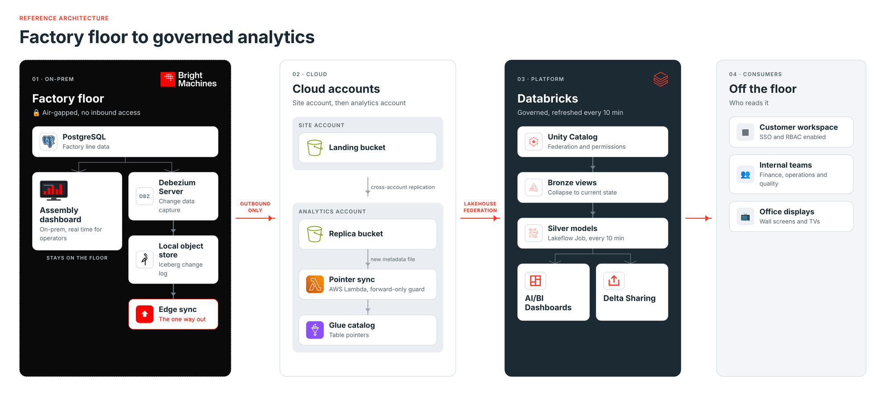

Rede de fábrica air-gapped existe por motivo sério, segurança operacional, não burocracia. O problema é que a maioria dos conector de ingestão de dado assume o caminho oposto, alguém de fora inicia conexão pra dentro, puxa o dado. Quando esse caminho simplesmente não pode existir, o conector mais moderno do mundo não ajuda em nada.

A Bright Machines documentou como resolveu esse problema especificamente, substituindo uma arquitetura de nove serviço frouxamente acoplado por um desenho mais simples baseado numa regra única, dado só pode sair, nada nunca entra.

## A regra de design: só pode sair, nunca entrar

O time considerou e descartou a opção óbvia primeiro, usar Lakeflow Connect puxando direto do PostgreSQL de linha de montagem, ou Auto Loader sobre exportação periódica do mesmo banco. Os dois exigem abrir algum caminho de rede pra dentro da planta, mesmo que limitado, o que contraria a premissa de segurança do ambiente. A alternativa adotada inverte a direção, tudo que sai da fábrica é empurrado por um componente dentro da própria rede da planta, nunca puxado de fora.

## O caminho do dado: do PostgreSQL de linha até o Unity Catalog

Na ponta da fábrica, o Debezium Server acompanha o replication slot do PostgreSQL que guarda dado de linha de montagem e grava um log de mudança no formato Apache Iceberg, em object storage local. Um componente único de sincronização de borda copia esses objetos pra um bucket na conta de nuvem do próprio site, usando credencial restrita a escrever só naquele bucket específico. Dali, replicação entre conta leva o dado até a conta de análise, onde uma função serverless avança o ponteiro de metadado do catálogo Glue só depois que um novo arquivo de metadado terminou de replicar por completo, e sempre pra frente, nunca revertendo. O Unity Catalog federa esse catálogo Glue como leitura, expondo mais de cem tabela sem precisar copiar dado de novo. Visão silver reconstrói estado atual a partir do log de mudança a cada dez minutos, via Lakeflow Job, com todo SQL versionado em Git e implantado via Declarative Automation Bundles.

## Mão na massa: heartbeat como diferença entre linha parada e pipeline quebrado

Um detalhe de operação que separa esse desenho de uma simples demonstração é como ele distingue "a fábrica está parada hoje" de "o pipeline quebrou e ninguém percebeu". O Debezium atualiza uma tabela de heartbeat de uma linha só a cada cinco minutos, e a primeira tarefa do Lakeflow Job falha o job inteiro se esse heartbeat estiver com mais de trinta minutos de atraso:

```python
from datetime import datetime, timezone, timedelta

def verificar_heartbeat(spark, limite_minutos=30):
    linha = spark.sql(
        "SELECT ultima_atualizacao FROM bronze.fabrica.heartbeat_debezium"
    ).collect()[0]

    agora = datetime.now(timezone.utc)
    atraso = agora - linha["ultima_atualizacao"]

    if atraso > timedelta(minutes=limite_minutos):
        raise RuntimeError(
            f"Heartbeat atrasado em {atraso}, pipeline pode estar quebrado "
            f"em vez de a linha estar genuinamente parada"
        )

    return True
```

A lógica por trás disso é simples mas fácil de esquecer num pipeline de borda, ausência de dado novo não é sinal suficiente de problema sozinha, porque linha de produção para por motivo legítimo o tempo todo. O heartbeat separa silêncio esperado de silêncio que precisa de alguém investigando.



**Minha leitura:** o ponto mais interessante desse desenho não é nenhuma peça tecnológica isolada, Debezium e Iceberg já são conhecidos, é a disciplina de reduzir uma arquitetura de nove serviço acoplado pra um único caminho de saída. Cada serviço a mais numa cadeia de ingestão é mais um ponto de falha silenciosa, e o ganho real reportado, de nove peças pra uma, provavelmente importa mais pra operação de longo prazo do que qualquer característica específica do Iceberg ou do Glue usados no meio do caminho.

## Rodando esse desenho no Azure Databricks: o hop de catálogo não tem equivalente direto

A peça mais específica de AWS nesse desenho é o catálogo Glue federado como leitura pelo Unity Catalog. Vale conferir o que o Unity Catalog realmente federa hoje no Azure Databricks antes de assumir que dá pra trocar Glue por outro serviço gerenciado equivalente: a lista de fonte suportada pra federação de catálogo é metastore Hive legado, metastore Hive externo, Salesforce Data 360, Snowflake, Palantir Foundry, Workday Data Connect e OneLake. A própria documentação cita Glue de passagem, como exemplo genérico de "plataforma de catálogo externo", mas ele não aparece na lista real de fonte suportada. Ou seja, o hop específico "Unity Catalog federando um catálogo Glue" não tem um substituto gerenciado direto no Azure hoje.

O caminho mais próximo confirmado é auto-hospedar o próprio metastore Hive, apontando pra um banco gerenciado no Azure (Azure Database for PostgreSQL, MySQL, ou Azure SQL Database) como catálogo de registro, no lugar do Glue, e federar esse metastore externo no Unity Catalog:

```sql
CREATE CONNECTION catalogo_fabrica TYPE hive_metastore
OPTIONS (
  host '<host-do-metastore-hive>',
  port '<porta>',
  user secret ('cofre_producao', 'hms_usuario'),
  password secret ('cofre_producao', 'hms_senha'),
  database '<nome-do-banco>',
  db_type 'POSTGRESQL',
  version '3.1'
);

CREATE FOREIGN CATALOG IF NOT EXISTS fabrica_federada USING CONNECTION catalogo_fabrica
OPTIONS (
  authorized_paths '<caminho-no-adls-gen2>',
  storage_root '<local-de-armazenamento-do-iceberg>'
);
```

A documentação é explícita que `storage_root` é obrigatório especificamente pra leitura de tabela Iceberg através desse caminho, não é um detalhe cosmético de metadado, sem ele a leitura falha mesmo que o restante do catálogo federado funcione normalmente. Isso muda a arquitetura de fundo, de "Glue como serviço gerenciado fazendo o papel de catálogo" pra "seu próprio metastore Hive auto-hospedado fazendo o mesmo papel", o que é uma peça a mais pra operar, não uma troca transparente.

As outras duas peças específicas de AWS têm equivalente mais direto: o object storage local e o bucket de destino viram Azure Data Lake Storage Gen2, e a credencial restrita a escrever só num bucket específico vira um SAS token ou uma role como Storage Blob Data Contributor restrita a um único container. Já a replicação entre conta de nuvem usada no desenho original eu não consegui confirmar na documentação do Azure Storage hoje (a página de visão geral do recurso de replicação de objeto não abriu), então não vale assumir paridade de comportamento com o que a Bright Machines descreve pro lado AWS sem checar a documentação atual primeiro.

## O que isso não resolve sozinho

O material divulgado não mostra a política de bucket, a lógica exata da função que avança o ponteiro do Glue, nem a definição completa do bundle usado em produção, então o padrão é replicável em princípio, mas não é algo que dá pra copiar e colar direto. As partes específicas de AWS, destino de sincronização de borda, replicação entre conta e o próprio hop de catálogo, precisam de adaptação pra outro provedor de nuvem, mesmo a Databricks confirmando que o lado interno da plataforma é portável. No Azure especificamente, essa adaptação não é trivial no hop de catálogo, já que Glue não é fonte suportada de federação e o caminho alternativo, metastore Hive externo auto-hospedado, é arquiteturalmente diferente de um catálogo gerenciado. E o artigo é coautoria do fornecedor com o cliente, os números de volume e cronograma (prova de conceito de seis semanas, primeiro dashboard em produção em dois meses) vêm sem auditoria independente.

## Vale a pena adotar o padrão?

Pra qualquer ambiente com restrição real de rede, não só fábrica, pensa em site remoto, ambiente regulado, parceiro que não aceita conexão de entrada, o princípio central vale a pena replicar, tratar a direção do fluxo de dado como decisão de segurança explícita, não como consequência acidental de qual conector foi mais fácil de configurar primeiro. O investimento real está em desenhar o mecanismo de avanço de ponteiro de metadado com a mesma disciplina mostrada aqui, só avançar depois de confirmar replicação completa, e nunca reverter, porque é exatamente esse detalhe que evita um catálogo apontando pra metadado inconsistente no meio de uma falha parcial de rede.

## Referências

- Databricks Blog, "Air gapped, not data dark: how Bright Machines gives customers live factory dashboards without opening the plant": https://www.databricks.com/blog/air-gapped-not-data-dark-how-bright-machines-gives-customers-live-factory-dashboards-without
- Databricks, Unity Catalog: https://www.databricks.com/product/unity-catalog
- Databricks, OpenSharing: https://www.databricks.com/product/opensharing
- Microsoft Learn, visão geral de Lakehouse Federation e fonte suportada no Azure Databricks: https://learn.microsoft.com/en-us/azure/databricks/query-federation/
- Microsoft Learn, federação com metastore Hive externo: https://learn.microsoft.com/en-us/azure/databricks/query-federation/hms-federation-external

#AzureDatabricks #UnityCatalog #EngenhariaDeDados #Industria
