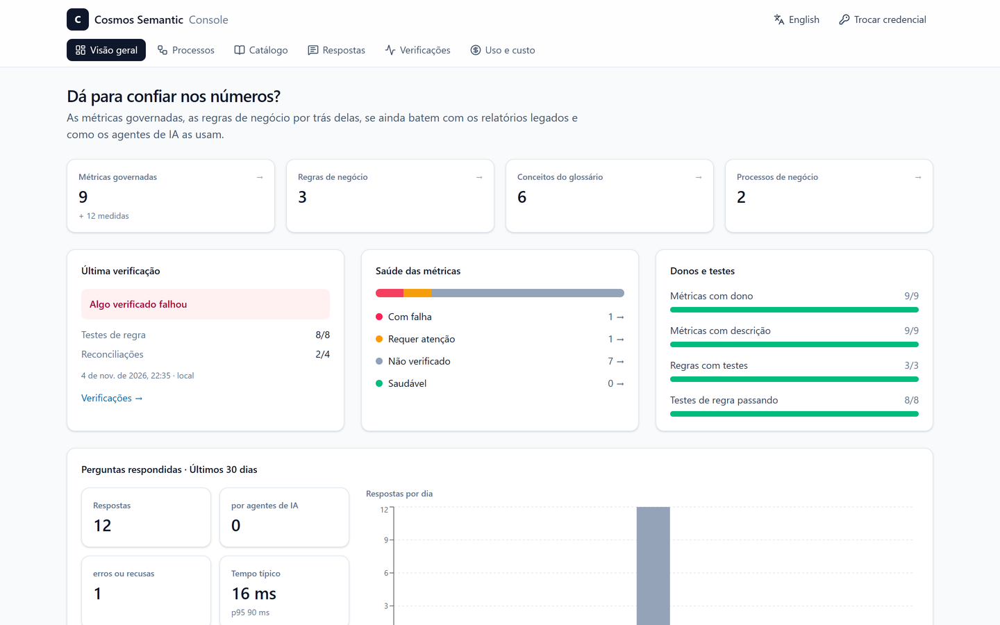
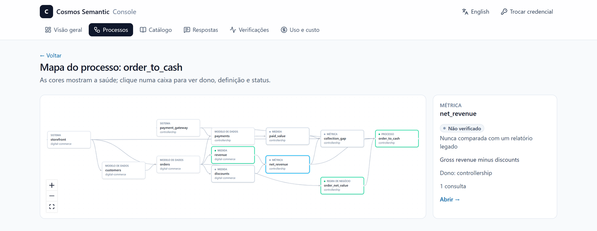
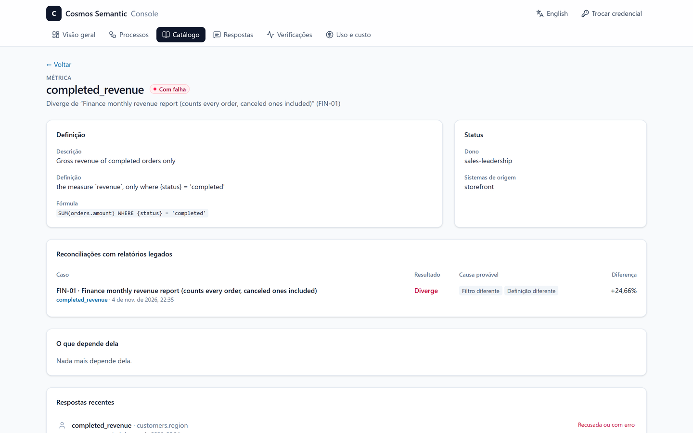
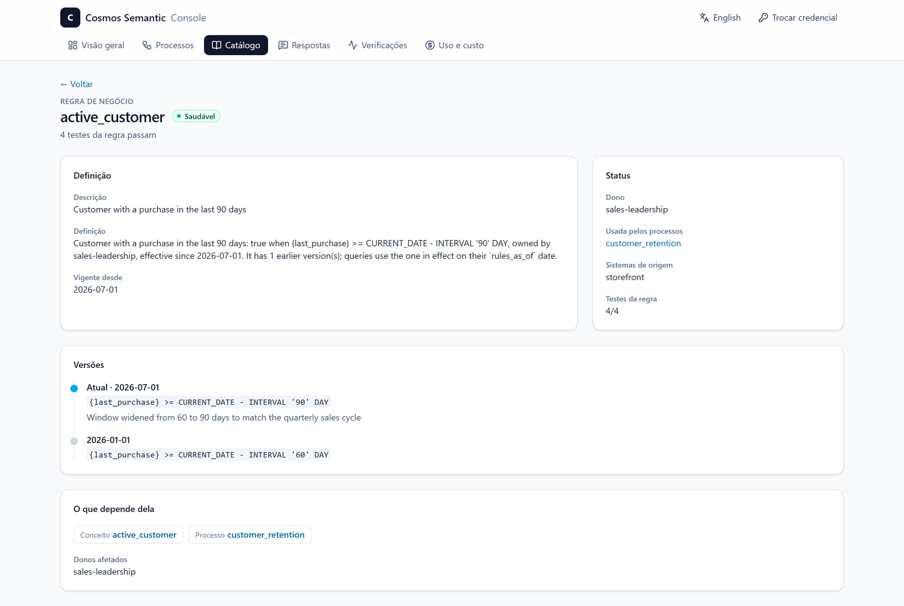
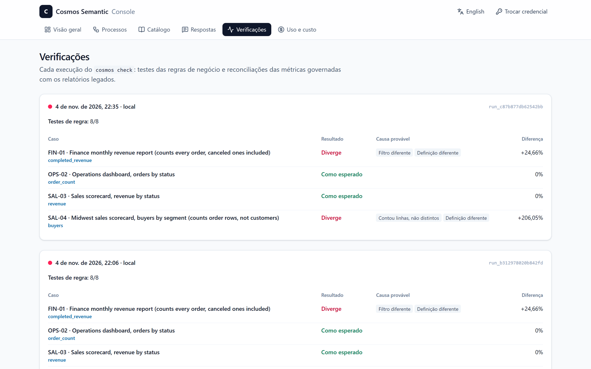
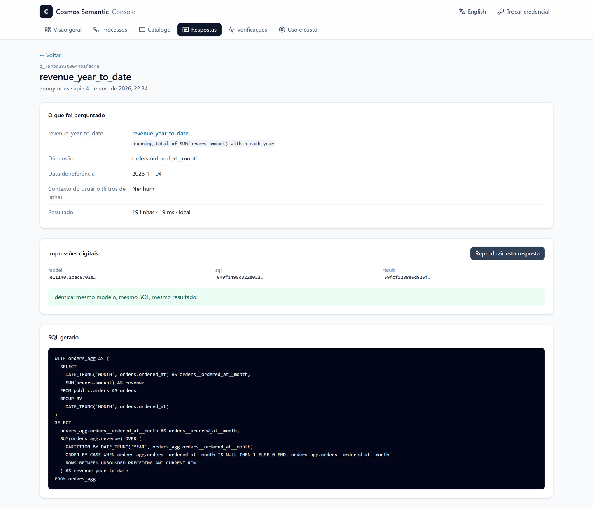

Toda empresa que já colocou um agente de IA pra responder pergunta de negócio esbarra no mesmo problema, e ele não é o modelo de linguagem. É o contexto. "Receita" tem três definições espalhadas em três dashboards, "cliente ativo" significa 60 dias pra um time e 90 pra outro, e o agente, sem saber disso, escreve um SQL plausível sobre as tabelas e devolve um número que parece certo. Ninguém consegue dizer de onde ele saiu.

Uma camada semântica resolve a primeira parte: define métrica, dimensão, relacionamento e regra uma vez, e serve o mesmo resultado pra todo mundo. A segunda parte, provar o número, quase ninguém resolve. Foi pra atacar as duas que eu construí o **Cosmos Semantic**, open source sob Apache 2.0: [github.com/WiliamRosa/cosmos-semantic-platform](https://github.com/WiliamRosa/cosmos-semantic-platform).

**Experimente sem instalar nada:** a [demonstração pública do console](https://wiliamrosa.github.io/cosmos-semantic-platform/) roda o modelo de exemplo com dados sintéticos.

## Em uma frase

Uma **camada semântica universal**, com **ontologia de negócio** e motor próprio. Você define entidades, métricas, conceitos e regras uma vez, num YAML com o vocabulário do dbt Semantic Layer. Depois disso, qualquer agente de IA, aplicação ou pessoa consulta **o mesmo número, em qualquer banco**, com o SQL gerado e executado direto na sua fonte de dados, e cada resposta traz a própria prova.

## O que o diferencia, em seis pontos

| Característica | O que significa na prática |
| --- | --- |
| **Multi-database e multiplataforma** | O mesmo modelo roda em oito bancos: Databricks, Snowflake, Oracle, SQL Server, Postgres, MySQL, MariaDB e DuckDB, na nuvem ou on-premises. Não é promessa de documentação: a suíte inteira compara os números entre os bancos a cada mudança |
| **Ontologia e grafo de conhecimento** | Glossário de negócio bilíngue (português e inglês) no padrão SKOS, regras de negócio versionadas, com dono e testes, e um grafo de times, sistemas e processos. O significado do dado deixa de viver na cabeça das pessoas |
| **Agentes de IA com assertividade** | O agente não adivinha SQL. Ele encontra o conceito certo pelo glossário, pede uma métrica governada pelo MCP e o motor gera um SQL determinístico: a mesma pergunta dá a mesma resposta, toda vez |
| **IA explicável e auditável** | Toda resposta vem com um envelope de evidências: fórmula expandida, regras aplicadas, filtros de acesso, data de referência e hashes. Meses depois, `cosmos replay` diz se o número mudou e por quê |
| **Governança desde o projeto** | Filtro de linha pela identidade do usuário (Entra ID), dado pessoal bloqueado pro canal de IA (LGPD) e log de auditoria de toda consulta. A política vive no motor, não no prompt |
| **Aberto e sem lock-in** | Apache 2.0, motor próprio e importação do que a empresa já tem: dbt, Power BI, Cube e Apache Ossie (o padrão aberto de interoperabilidade semântica, antigo OSI). Trocar de plataforma não obriga a reescrever as definições de negócio |

## Por que isso importa pra quem lidera dados e IA

Quando um agente começa a responder pergunta de negócio, a pergunta que chega na mesa de quem lidera dados deixa de ser "funciona?" e passa a ser "posso confiar, e consigo provar?". O Cosmos foi desenhado em volta dessa segunda pergunta:

- **Confiança auditável, não declarada.** Quando a diretoria contestar um número do agente, a resposta é um registro que dá pra reproduzir, e não uma investigação de dois dias.
- **Uma fonte única da verdade que atravessa plataformas.** Dado espalhado entre Databricks, Snowflake, Oracle e SQL Server é a regra, não a exceção. A definição de "receita" é uma só, e o número bate em todos eles.
- **Modernização sem números divergentes.** Quem está migrando relatório de SQL Server ou Oracle pra Databricks ou Snowflake compara a métrica governada com o SQL legado e vê a causa provável de cada diferença, antes de desligar o relatório antigo.
- **Mudança com dono e com histórico.** Antes de mudar uma definição, dá pra ver quem será afetado; depois de mudar, dá pra medir o efeito.
- **FinOps de IA.** Uso e custo estimado por métrica, por agente e por fonte mostram quem consulta o quê e quanto isso custa no warehouse.
- **Risco e compliance sob controle.** O que um agente pode ver é decidido pela identidade de quem pergunta, e dado pessoal nunca chega até ele.

## Números verificáveis: a prova vem junto com a resposta

A maioria das camadas semânticas para no "a métrica está definida em um lugar só". No Cosmos, toda resposta vem com um envelope de evidências:

```text
evidence  q_2eae279c2b6b494da485
  model   edb8d14a70cd1e35  engine 0.1.0
  as of   2026-11-04 (America/New_York)  source local (duckdb)
  metric  revenue = SUM(orders.amount)
  lineage orders
  sql     eb5ca2c843244937  result 451c5e52d6f85089 (3 rows)
```

Ele traz:
- a fórmula expandida da métrica;
- as regras de negócio que entraram, com dono, vigência e status dos testes;
- os filtros de linha aplicados ao usuário e a fonte de onde o número veio;
- a data de referência: "hoje" é fixado no fuso do modelo, não no relógio de cada servidor;
- os hashes do modelo, do SQL e do resultado.

É a linhagem do número, e não só da tabela.

Em cima dessas evidências vêm três ferramentas que considero o coração do projeto:

- **Reconciliação** (`cosmos reconcile`): compara a métrica governada com o SQL legado que alguém já usa e diz a causa provável da divergência, como:
  - filtro diferente;
  - linhas multiplicadas num join;
  - divisão inteira;
  - média truncada;
  - dia cortado em UTC em vez do fuso de negócio.

  Testei contra um "zoológico" de nove erros clássicos plantados de propósito, mais uma consulta correta como controle.
- **Análise de impacto** (`cosmos impact`): antes de mudar uma regra ou métrica, mostra tudo que depende dela, quem é o dono de cada parte e quem consultou aquilo.
- **Regras com vigência**: quando "cliente ativo" passou de 60 pra 90 dias, a regra guardou as duas versões. Uma consulta de junho usa a regra que valia em junho, e a diferença entre as duas é exatamente o efeito da mudança.

## A ontologia como contexto para agentes de IA

O que faz um agente acertar não é um prompt maior: é contexto de negócio estruturado. No Cosmos, esse contexto é uma ontologia com três camadas:

1. **Glossário** com rótulos e sinônimos em português e inglês, exportável em SKOS/RDF pra catálogos de dados. "Compradores ativos" chega em `active_customer`.
2. **Regras de negócio** com dono, vigência, versões e testes, que viram filtros e dimensões reutilizáveis.
3. **Grafo de conhecimento** com times, sistemas e processos: quem é dono de quê, de qual sistema o dado vem e qual processo depende de cada métrica.

O servidor **MCP** nativo expõe isso ao agente em cinco ferramentas (`search_concepts`, `explain`, `list_members`, `query` e `show_sql`). Duas garantias valem pra todo canal:

1. **Filtro de linha pelo usuário.** O contexto vem do token do provedor de identidade e entra no SQL. O agente de um gerente regional só vê a região dele.
2. **Dado pessoal nunca chega ao agente.** Colunas classificadas como pessoais ou sensíveis não podem ser agrupadas nem filtradas pelo canal de IA:

```text
error: `customers.email` is personal data (LGPD) and never reaches AI agents,
neither as a grouping nor as a filter
```

### A IA sugere, o motor valida

O `cosmos suggest` usa o Claude pra propor sinônimos, descrições e regras de negócio a partir do modelo. Nada é aplicado automaticamente: cada sugestão precisa rodar em todos os bancos que o modelo atende, regras derivadas incluídas, e depois passa pela revisão de uma pessoa. Na primeira rodada contra a API real, ele aceitou umas 28 sugestões em cerca de 30 segundos, quase todas boas. Também propôs um sinônimo errado ("inadimplência" pra "collection gap"), que é exatamente o motivo da revisão humana.

O resultado mais útil foi outro. Uma regra sugerida expôs um bug de precedência no motor: uma expressão substituída perdia os parênteses e mudava de sentido sem dar erro. Os testes escritos à mão não pegaram esse caso; a sugestão da IA pegou, e o caso virou teste de regressão. Pra mim é o modelo certo de IA em dados: ela amplia o que dá pra testar, mas não tem a palavra final.

## Multi-database de verdade: o mesmo número em oito bancos

"Multiplataforma" é fácil de escrever e difícil de provar. A suíte inteira roda contra cada fonte:
- as consultas de referência, comparadas com SQL escrito à mão;
- 80 requisições aleatórias que precisam dar exatamente o mesmo número em todos os bancos;
- a reconciliação, o rascunho de modelo e a importação do Power BI.

Hoje são oito bancos:

| Plataforma | Como foi validada |
| --- | --- |
| Databricks | SQL Warehouse serverless com Unity Catalog |
| Snowflake | warehouse com login por par de chaves |
| Oracle | Oracle Database 23ai Free, a cada pull request |
| SQL Server, Postgres, MySQL, MariaDB | em contêiner, a cada pull request |
| DuckDB | local, sem servidor |

Cada banco trouxe pontos de atenção devido a suas características, e várias mudariam o número em silêncio:
- O **Databricks** informa inteiros como `LONG` no catálogo.
- O **Snowflake** divide inteiros com casas decimais, e o primeiro dia da semana depende da sessão.
- **MySQL e MariaDB** não têm `DATE_TRUNC`.
- O **Oracle** tem um `CURRENT_DATE` que traz a hora do dia, e um `DOUBLE PRECISION` que é, na verdade, decimal.

Nenhuma dessas diferenças aparece numa demo. Aparecem quando a mesma pergunta precisa dar o mesmo número em plataformas diferentes, e é essa garantia que uma empresa com dado em mais de um lugar precisa.

## Um console para quem decide

Nem todo mundo que precisa confiar no número vai abrir um terminal. Por isso a versão 0.3 traz um **console web de leitura**, em inglês e português, servido pelo próprio `cosmos serve`. Ele foi pensado para diretores de dados e de IA e para gerentes de governança, e dá pra navegar nele agora, sem instalar nada, na [demonstração pública](https://wiliamrosa.github.io/cosmos-semantic-platform/), com dados sintéticos.



**Visão geral.** A primeira tela responde à pergunta de quem decide: dá para confiar nos números? Ela mostra a saúde das métricas, os donos e testes, a última verificação contra os relatórios legados e as perguntas respondidas pelos agentes. Cada número é um link para a lista por trás dele.



**Mapa de cada processo de negócio.** Dos sistemas de origem até as métricas e regras, com cada parte colorida pela saúde. Clicar numa caixa mostra o dono, a definição e o status. É o grafo de conhecimento visto por quem é dono do processo.



**Métrica com divergência.** Quando um relatório legado não bate, a ficha da métrica mostra o caso, a causa provável e o tamanho da diferença. No exemplo, o relatório financeiro soma pedidos cancelados e fica 24,66% acima da métrica governada.



**Regras com vigência.** A regra de "cliente ativo" mostra as duas versões numa linha do tempo, de 60 para 90 dias, com o motivo da mudança, os testes e o que depende dela.



**Verificações.** Cada execução do `cosmos check` testa as regras e reconcilia as métricas com os relatórios legados, apontando a causa provável de cada diferença.



**Respostas auditadas.** Cada número que um agente recebeu, com fórmula, contexto do usuário, SQL e impressões digitais, mais um botão que reproduz a resposta e diz se algo mudou.



É observabilidade da camada semântica: dá pra ver o que está saudável, o que diverge e por quê, sem pedir a ninguém do time técnico.

## Mão na massa: do pip ao primeiro número

Tudo roda localmente em DuckDB, sem servidor e sem conta:

```bash
pip install "cosmos-semantic[duckdb,testdata]"
cosmos init demo && cd demo
cosmos demo-data
cosmos query revenue average_order_value --by orders.status --evidence
cosmos explain rule:active_customer
```

O `cosmos init` cria um projeto com o modelo de exemplo (um e-commerce com pedidos, itens, pagamentos, clientes, produtos e vendedores) e o `cosmos demo-data` gera dados sintéticos. Pra ligar um agente, o projeto já vem com uma chave de desenvolvimento, e no Claude Code basta um `claude mcp add`. Pra apontar pros seus bancos, instale os extras que precisar, por exemplo `pip install "cosmos-semantic[databricks,snowflake,oracle]"`. O passo a passo completo está no [quickstart](https://github.com/WiliamRosa/cosmos-semantic-platform/blob/main/docs/quickstart.md).

Também vêm no pacote:
- importação de modelos do **Power BI** (`.bim` e TMDL), traduzindo o DAX simples e avisando tudo que não tem equivalente;
- um **rascunho de modelo direto do banco** (`cosmos bootstrap`), sem IA, em poucos segundos;
- um **pacote de varejo** que se adapta às tabelas de quem usa.

## O que ainda não tem

Prefiro ser direto sobre o que falta:
- não há cache de resultado;
- não há endpoint SQL pra conectar Power BI e Excel direto à camada. Está pausado de propósito até ter usuários dizendo que vale o esforço;
- não há produto gerenciado;
- o login do console por enquanto é por chave ou token colado, sem o fluxo do provedor de identidade no navegador.

O formato de autoria ainda pode mudar antes da 1.0, sempre registrado no changelog.

## Como avaliar na sua empresa

Um piloto pequeno basta pra saber se isso resolve um problema real seu:

1. **Escolha três métricas que geram discussão hoje**, aquelas que têm mais de um número circulando em reunião.
2. **Traga o que já existe:** importe o modelo do Power BI ou do dbt, ou gere um rascunho direto do banco com `cosmos bootstrap`.
3. **Rode a reconciliação contra o SQL legado** de cada uma e veja se as causas apontadas batem com o que o time já desconfiava.
4. **Ligue um agente pelo MCP** com um usuário de teste e confira o que ele consegue e o que não consegue ver.

Em poucas horas dá pra saber se o resultado convence o time e quem cobra o time.

## Como ajudar

Se você trabalha com dados e já brigou com número divergente, eu adoraria que testasse com um modelo seu, nem que seja importando um projeto dbt ou um modelo do Power BI pra ver se os números batem. Issue, crítica e pull request são muito bem-vindos no [repositório](https://github.com/WiliamRosa/cosmos-semantic-platform). E se quiser conversar sobre o projeto, ou sobre um piloto na sua empresa, me chama no LinkedIn.
