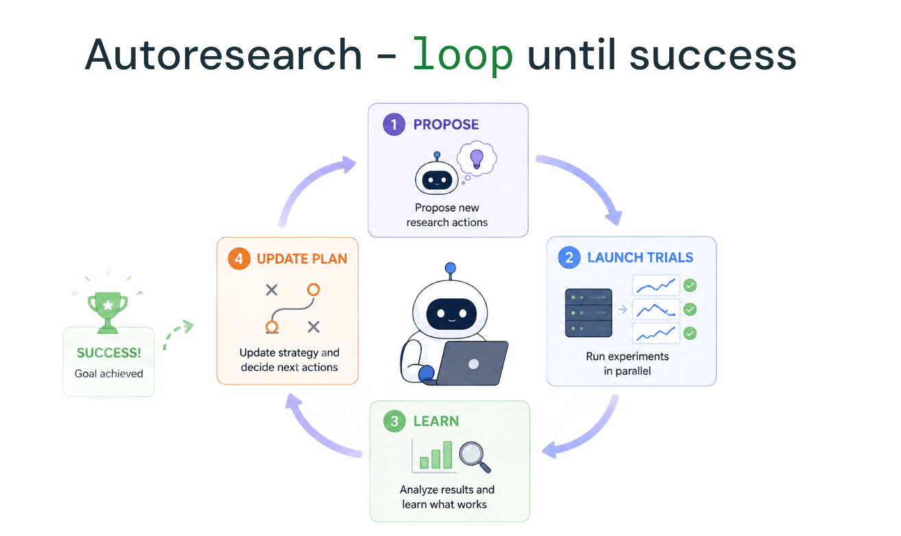

Toda plataforma de infraestrutura de IA enfrenta a mesma pergunta incômoda: o time que constrói usa a própria ferramenta do jeito que recomenda pro cliente, ou mantém um caminho interno mais rápido e menos documentado? O time de pesquisa por trás de função de IA como `ai_parse_document` e `ai_extract` respondeu isso descrevendo publicamente como usa o próprio AI Runtime desde o lançamento, como "cliente zero", pra treinar desde modelo de poucos bilhões de parâmetro até modelo que chega perto de um trilhão.

## GPU que se autodiagnostica antes do treino começar

Antes de qualquer job de treino começar, o AI Runtime verifica a saúde do nó alocado e a comunicação entre nó, e continua monitorando durante a execução inteira, atrás de falha de comunicação de rede entre GPU, superaquecimento, limitação de energia e problema de driver. Quando um nó falha durante um job, ele é isolado automaticamente, job seguinte evita alocar ali até alguém investigar o problema. Isso importa porque treino distribuído em escala de centena de GPU por dias ou semana tem probabilidade cumulativa alta de pelo menos um nó falhar em algum momento, detectar isso automaticamente evita que uma falha de hardware vire hora de depuração manual perdida no meio de um treino caro.

## O loop de autoresearch: agente propondo e ajustando sozinho

O mecanismo mais distinto descrito não é a infraestrutura de GPU em si, é um loop contínuo onde agente de IA propõe mudança de configuração ou abordagem, dispara múltiplo teste em paralelo no AI Runtime, avalia a métrica de treino resultante, e atualiza o próprio plano de pesquisa com base nisso, sem intervenção manual a cada iteração. O time reporta que esse padrão, aplicado a pesquisa de função de IA, multiplicou por oito o volume de job de treino executado no mesmo período, uma métrica de throughput de experimentação, não de qualidade de resultado final, mas ainda assim um indicador direto de quanto esse tipo de automação muda a velocidade de iteração.

## Mão na massa: a forma de um ciclo de autoresearch

O princípio do loop de quatro etapas é replicável fora do contexto específico de pesquisa de função de IA, qualquer time com acesso a GPU gerenciada e métrica de treino bem definida pode estruturar algo parecido:

```python
def ciclo_autoresearch(plano_atual, numero_max_ciclos):
    for ciclo in range(numero_max_ciclos):
        # 1. Agente propoe variacao a partir do plano e resultado anterior
        candidatos = agente_propor_variacoes(plano_atual)

        # 2. Dispara teste em paralelo via CLI do AI Runtime
        execucoes = [
            lancar_job_ai_runtime(config=c, gpus=c.numero_gpus)
            for c in candidatos
        ]

        # 3. Agente avalia metrica de treino de cada execucao via MLflow
        resultados = [
            agente_avaliar_metricas(mlflow_experiment_id=e.experiment_id)
            for e in execucoes
        ]

        # 4. Agente atualiza o plano com base no que funcionou melhor
        plano_atual = agente_atualizar_plano(plano_atual, resultados)

        if agente_decidir_parar(plano_atual, resultados):
            break

    return plano_atual
```

O ponto que sustenta esse loop inteiro é o AI Runtime cuidar de provisionamento, agendamento e rede entre nuvem de forma programática, deixando o agente livre pra focar na decisão de pesquisa em si, propor variação e interpretar resultado, em vez de gastar ciclo gerenciando infraestrutura.

## Reaproveitando ambiente sem reconstruir container a cada execução

Um detalhe prático que facilita rodar o loop acima em volume alto é reaproveitar imagem Docker já usada localmente, registrada e compartilhada via Databricks Artifact Registry, o time reporta tempo de início de job na casa de segundos. Isso importa especificamente num loop de autoresearch porque cada ciclo dispara múltiplo job novo, se cada um exigisse reconstruir ambiente do zero, o overhead por ciclo cresceria rápido o suficiente pra anular boa parte do ganho de velocidade que o próprio loop promete entregar.



**Minha leitura:** o número de oito vezes mais job de treino é informativo, mas isoladamente não prova que o time chegou a resultado de pesquisa melhor, só que itera mais rápido. Rodar mais experimento errado mais rápido não é progresso, é só mais ruído em volume maior. O material de origem não detalha como o próprio loop decide quando parar de explorar uma direção que não está dando resultado, esse critério de parada é exatamente onde eu testaria com mais cuidado antes de replicar esse padrão, porque é o ponto mais fácil de um loop automatizado continuar gastando GPU em caminho que um pesquisador humano já teria abandonado.

## O que isso não resolve sozinho

O material de origem é uma descrição de alto nível, sem código, configuração, tamanho de cluster usado por experimento nem detalhe de benchmark que permita reproduzir o loop exatamente como descrito. O pacote `databricks-air-skills`, mencionado como parte da integração do agente com a CLI, não vem acompanhado de documentação pública detalhada no material disponível. E nenhum número de custo é reportado, rodar centena de GPU por dia ou semana, multiplicado por oito vezes mais job, tem implicação financeira que qualquer time replicando esse padrão precisa modelar por conta própria antes de comprometer orçamento.

## Vale a pena adotar o padrão?

O valor real de documentar isso publicamente não é o número de oito vezes em si, é a confirmação de que a própria Databricks usa a infraestrutura gerenciada que vende, em vez de manter um caminho interno paralelo mais rápido e menos governado. Pra qualquer time de pesquisa de IA considerando automatizar parte do próprio ciclo de experimentação, o padrão de quatro etapas, propor, testar em paralelo, avaliar, ajustar, é um ponto de partida razoável, mas vale desenhar com cuidado o critério de parada antes de deixar o agente rodar sem supervisão por período longo.

## Referências

- Databricks Blog, "How our AI Research team uses AI Runtime": https://www.databricks.com/blog/how-our-ai-research-team-uses-ai-runtime
- Databricks Docs, AI Runtime: https://docs.databricks.com/aws/en/machine-learning/ai-runtime/
- Microsoft Learn, AI Runtime no Azure Databricks: https://learn.microsoft.com/en-us/azure/databricks/machine-learning/ai-runtime/
- Databricks Docs, funções de IA (AI Functions): https://docs.databricks.com/aws/en/large-language-models/ai-functions

#AzureDatabricks #AIRuntime #AgentesDeIA #MLOps
