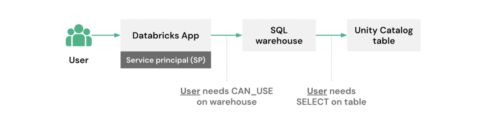

Todo Databricks App nasce com uma identidade própria, um service principal dedicado que o app usa pra acessar recurso do workspace. Isso resolve bem um tipo de problema, rodar tarefa em segundo plano, acessar configuração compartilhada, chamar serviço externo, mas quebra na primeira vez que dois usuários diferentes precisam ver dado diferente dentro do mesmo app. Com só a identidade do service principal em jogo, todo mundo que abre o app enxerga exatamente o mesmo recorte de dado, porque a permissão avaliada é sempre a mesma, não importa quem clicou.

A autorização on-behalf-of-user, agora disponibilidade geral, resolve isso encaminhando o token de acesso de quem está logado pra dentro do próprio código do app, fazendo o Unity Catalog aplicar a permissão individual de cada pessoa automaticamente, sem o desenvolvedor precisar reimplementar controle de acesso dentro da aplicação.

## Dois modelos de identidade, uma escolha por operação

Um Databricks App convive com duas identidades em paralelo, e a escolha entre elas não é um interruptor global, é uma decisão por operação dentro do mesmo código. Autorização de app usa o service principal dedicado, ótimo pra ação que não depende de quem está olhando, gravar log, rodar tarefa agendada, consultar configuração compartilhada. Autorização de usuário usa o token de quem está logado, certo pra qualquer ação que precisa respeitar permissão individual, consultar tabela com row filter, acessar warehouse SQL, disparar job em nome da pessoa. Um mesmo app pode usar as duas ao mesmo tempo, gravando métrica com a identidade do app enquanto consulta dado filtrado com a identidade do usuário.

## Como o token do usuário chega até o seu código

O mecanismo central é encaminhamento de cabeçalho HTTP. Quando o app usa autorização de usuário, o Databricks injeta o token de acesso da pessoa logada no cabeçalho `x-forwarded-access-token` de cada requisição que chega no app. O framework usado do lado da aplicação muda como você lê esse cabeçalho, Flask lê via `request.headers`, Streamlit via `st.context.headers`, Express via `req.header(...)`, mas o princípio é sempre o mesmo: o token existe só durante aquela requisição específica, então ele precisa ser lido e usado dentro do handler da requisição, nunca guardado em variável global nem gravado em log.

## Mão na massa: aplicando row filter automático num dashboard de vendas

Um dashboard de vendas por região é o exemplo mais direto de onde isso importa. Sem autorização de usuário, todo vendedor vê a tabela inteira ou nenhum vendedor vê nada, porque a permissão é a do service principal, não a da pessoa. Com autorização de usuário e um row filter já configurado no Unity Catalog pra restringir visibilidade por região do vendedor, o mesmo código de consulta devolve resultado diferente pra cada pessoa, sem precisar escrever `WHERE regiao = ...` manualmente:

```python
from databricks import sql
from databricks.sdk.core import Config
from flask import request

cfg = Config()

def consultar_vendas_do_usuario():
    token_usuario = request.headers.get("x-forwarded-access-token")
    if not token_usuario:
        raise RuntimeError("Token de usuario ausente, recusando fallback para service principal")

    conexao = sql.connect(
        server_hostname=cfg.host,
        http_path="/sql/1.0/warehouses/<id-do-warehouse>",
        access_token=token_usuario,
    )

    with conexao.cursor() as cursor:
        cursor.execute("SELECT regiao, cliente, valor_pedido FROM vendas.gold.pedidos")
        linhas = cursor.fetchall_arrow().to_pandas()

    conexao.close()
    return linhas
```

A parte que importa não é a sintaxe de conexão em si, já conhecida de quem usa o conector SQL, é o `raise` explícito quando o token não chega. Deixar o código cair de volta pro service principal nesse caso específico reabriria exatamente o buraco que a autorização de usuário existe pra fechar, qualquer pessoa passaria a ver o recorte de dado do service principal em vez do próprio.

## Escopo não é concessão de acesso, é teto

Autorização de usuário não dá ao app acesso total ao que a pessoa já pode fazer, o app precisa declarar escopos específicos, como `sql`, `genie`, `files` ou `sql:restricted-query` pra consulta somente leitura, e fica travado nesses limites mesmo que o usuário individualmente tenha permissão pra mais. Se o app só pede o escopo `sql`, ele não consegue chamar endpoint de model serving através daquele usuário, mesmo que essa pessoa consiga fazer isso fora do app. No primeiro acesso, o usuário precisa consentir explicitamente com os escopos pedidos, um consentimento por app e conjunto de escopos, revogável depois.

## Quem trava o que: admin de workspace e admin de conta

Existe uma segunda camada de controle, independente do escopo que o desenvolvedor pede no código: o admin de workspace mantém uma lista de permissão de escopos em Configurações, Desenvolvimento, Apps, que por padrão libera todas as APIs suportadas, mas pode ser restringida, até reduzida a nenhuma, desligando autorização de usuário pro workspace inteiro. Admin de conta consegue conceder escopo fora dessa lista de permissão quando necessário. Um detalhe prático que vale testar antes de depender disso em produção: se um escopo já em uso for removido da lista de permissão depois, o app que já está rodando continua rodando, mas fica impedido de iniciar, implantar ou atualizar até o escopo não permitido ser removido da configuração do app.



**Minha leitura:** o ponto que separa isso de só mais uma opção de configuração é o comportamento de falha. O modelo inteiro assume que, sem token do usuário, o app não deveria simplesmente continuar funcionando com outra identidade silenciosamente, deveria recusar a operação. Isso é uma escolha de design que prioriza clareza de segurança sobre conveniência de disponibilidade, e é o tipo de detalhe que só aparece importante quando alguém, em algum momento, tenta depurar por que um usuário específico está vendo dado que não deveria.

## O que isso não resolve sozinho

O token encaminhado é restrito ao workspace onde o app roda, então não dá pra usar esse mesmo token pra consultar um warehouse SQL que vive em outro workspace, nesse caso a alternativa documentada é hospedar o app no workspace certo ou cair pra autenticação M2M via service principal, abrindo mão do controle por usuário naquele trecho específico. Auditoria de ação também não acontece sozinha: a Databricks recomenda registrar log estruturado de cada ação feita em nome do usuário, identidade, tipo de ação, recurso alvo, status, mas isso é responsabilidade de quem escreve o app, não algo que a plataforma garante de graça. E como o token só existe durante uma requisição ativa de usuário, esse modelo não serve pra tarefa em segundo plano nem job agendado, que precisam continuar usando a identidade do service principal.

## Vale a pena adotar?

Pra qualquer Databricks App que hoje mostra o mesmo recorte de dado pra todo mundo só porque a autorização usa o service principal compartilhado, essa é uma mudança de arquitetura que vale a pena revisar, porque reaproveita o row filter e a column mask que o Unity Catalog já aplica em qualquer outro acesso, sem duplicar lógica de permissão dentro do código do app. O investimento real está em dois lugares, desenhar o fail-closed corretamente quando o token não chega, e alinhar com o admin do workspace sobre quais escopos realmente fazem sentido liberar antes de distribuir o app pra um público maior.

## Referências

- Databricks Blog, "Now GA: Building permission-aware Databricks Apps with on-behalf-of-user authorization": https://www.databricks.com/blog/now-ga-building-permission-aware-databricks-apps-behalf-user-authorization
- Databricks Docs, autorização em Databricks Apps: https://docs.databricks.com/aws/en/dev-tools/databricks-apps/auth
- Microsoft Learn, autorização em Databricks Apps no Azure Databricks: https://learn.microsoft.com/en-us/azure/databricks/dev-tools/databricks-apps/auth
- Databricks Docs, autenticação de agente customizado: https://docs.databricks.com/aws/en/agents/custom-agents/agent-authentication

#AzureDatabricks #DatabricksApps #UnityCatalog #Seguranca
