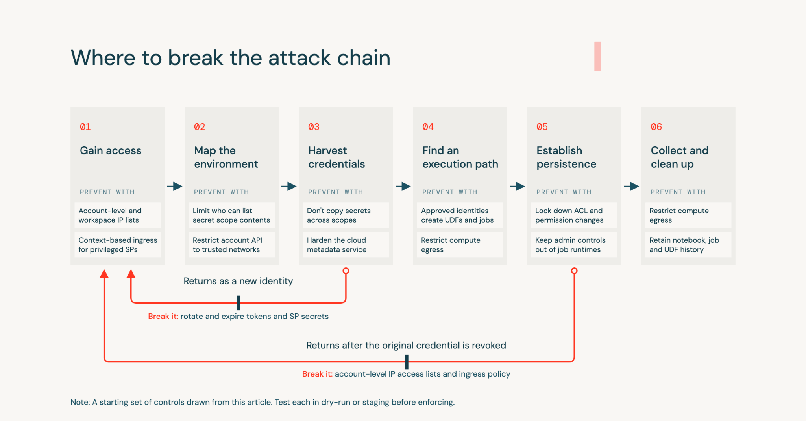

Um atacante com credencial válida roubada não dispara alarme nenhum olhando evento por evento. Login de token, chamada de listagem, leitura de segredo, criação de função, tudo isso acontece o tempo todo em qualquer workspace saudável, feito por gente legítima. O que denuncia o ataque não é nenhum desses eventos isolado, é a sequência deles acontecendo fora da ordem normal, e vindo de uma identidade que nunca tinha feito aquilo antes.

Pesquisa de segurança publicada recentemente pela Databricks documenta exatamente esse raciocínio, organizado em torno de um modelo de seis estágios de ataque, sem depender de modelo de machine learning nem de score de anomalia complexo.

## O modelo de seis estágios por trás do ataque

A sequência documentada segue uma lógica de progressão bem definida: ganhar acesso com credencial já válida, mapear o ambiente disponível, colher credencial adicional espalhada pelo workspace, achar um caminho de execução que aproveite essas credenciais, estabelecer persistência pra sobreviver à revogação do acesso original, e por fim coletar dado e tentar limpar rastro. Cada estágio tem assinatura própria no log de auditoria, mas só faz sentido como ataque quando lido em conjunto com os estágios vizinhos, não isoladamente.

## Por que correlação de sequência vence detecção por assinatura isolada

O ponto central do material é que nenhum evento único, olhado sozinho, separa uso legítimo de ataque. O que funciona é cruzar três coisas: a ordem não linear dos eventos (login de token seguido de mapeamento, seguido de leitura de segredo, seguido de criação de função), o desvio em relação ao próprio histórico daquela identidade (primeira vez que lista segredo, primeira vez que cria função, primeira negação de acesso por IP), e limiar simples de volume dentro de janela curta, como cinco chamada de API de descoberta diferente dentro de um minuto. Negação correlacionada com sucesso posterior na mesma credencial, e identidade trocando de compute logo depois de uma falha, também entram como sinal.

## Mão na massa: cruzando leitura negada e leitura bem sucedida de segredo

Um padrão de alto sinal citado na pesquisa é a leitura de um segredo específico ser negada, seguida pouco depois de sucesso numa chave relacionada, dentro da mesma sessão. Uma consulta que aproxima esse padrão direto no `system.access.audit`:

```sql
WITH tentativas_segredo AS (
  SELECT
    user_identity.email AS identidade,
    request_params.scope AS escopo,
    request_params.key AS chave,
    response.status_code AS status,
    event_time
  FROM system.access.audit
  WHERE action_name = 'getSecret'
    AND event_time >= current_timestamp() - INTERVAL 1 HOUR
)
SELECT
  negada.identidade,
  negada.escopo,
  negada.event_time AS momento_negado,
  sucesso.chave AS chave_bem_sucedida,
  sucesso.event_time AS momento_sucesso
FROM tentativas_segredo negada
JOIN tentativas_segredo sucesso
  ON negada.identidade = sucesso.identidade
  AND negada.escopo = sucesso.escopo
  AND sucesso.event_time BETWEEN negada.event_time AND negada.event_time + INTERVAL 10 MINUTES
WHERE negada.status = 403
  AND sucesso.status = 200
ORDER BY negada.event_time DESC;
```

O princípio por trás dessa consulta é o mesmo que sustenta o modelo inteiro, negação isolada não significa nada, mas negação seguida de sucesso relacionado, na mesma janela curta de tempo, é exatamente o tipo de padrão que alguém testando limite de acesso deixaria pra trás.



## No Azure Databricks, o sinal pode chegar antes do workspace

Boa parte do primeiro estágio, login com credencial já válida, acontece via autenticação federada com o Microsoft Entra ID antes de qualquer evento aparecer no `system.access.audit` do workspace. Isso significa que o Entra ID Protection já pode ter sinalizado risco na própria sessão de login, antes de o atacante tocar em qualquer recurso do Azure Databricks.

Dois detectores do Entra ID Protection importam especificamente pro primeiro estágio: credencial vazada (`leakedCredentials`, cálculo assíncrono, disponível a partir do Entra ID Free ou P1, sempre classificado como risco alto) e viagem impossível (`unlikelyTravel`, detecção em tempo real, exige Entra ID P2). Nenhum dos dois depende de nada específico do Azure Databricks, mas os dois cobrem exatamente o momento que o modelo de seis estágios trata como ponto de entrada.

A API de detecção de risco do Entra ID Protection, via Microsoft Graph (`GET /identityProtection/riskDetections`, exigindo a permissão `IdentityRiskEvent.Read.All` e licença Entra ID P1 ou P2), devolve, entre outros campos, `riskEventType`, `riskLevel`, `userPrincipalName` e `activityDateTime`. Ingerindo esse resultado numa tabela própria via job agendado, dá pra cruzar risco de sessão de login com o que aconteceu depois dentro do workspace:

```sql
WITH login_com_token AS (
  SELECT
    user_identity.email AS identidade,
    event_time AS momento_login
  FROM system.access.audit
  WHERE action_name = 'tokenLogin'
    AND event_time >= current_timestamp() - INTERVAL 24 HOURS
),
risco_entra_id AS (
  SELECT
    user_principal_name AS identidade,
    risk_event_type,
    risk_level,
    activity_date_time
  FROM seguranca.entra_id.deteccoes_risco
  WHERE risk_level IN ('high', 'medium')
)
SELECT
  login_com_token.identidade,
  login_com_token.momento_login,
  risco_entra_id.risk_event_type,
  risco_entra_id.risk_level
FROM login_com_token
JOIN risco_entra_id
  ON login_com_token.identidade = risco_entra_id.identidade
  AND risco_entra_id.activity_date_time
    BETWEEN login_com_token.momento_login - INTERVAL 1 HOUR
    AND login_com_token.momento_login + INTERVAL 1 HOUR
ORDER BY login_com_token.momento_login DESC;
```

A tabela `seguranca.entra_id.deteccoes_risco` não vem de nenhum conector pronto, é algo que o próprio time de segurança monta, chamando a API do Microsoft Graph periodicamente via Lakeflow Job e gravando o resultado como mais uma tabela governada. O ganho de cruzar as duas fontes é enxergar a janela entre "login já veio arriscado" e "credencial sendo efetivamente usada dentro do workspace", que é exatamente o intervalo onde revogar acesso ainda evita o estágio dois em diante.

Vale uma nota também sobre o estágio de colheita de credencial especificamente no Azure: segredo lido de um schema do Unity Catalog com Azure Key Vault por trás, recurso ainda em Beta, gera registro de auditoria no Unity Catalog com a identidade do Azure Databricks que fez a leitura, então cai dentro do mesmo `system.access.audit` já monitorado. Já o modelo mais antigo de secret scope com Key Vault por trás, onde o cofre inteiro fica exposto de uma vez ao workspace, não tem essa cobertura documentada oficialmente, vale testar diretamente antes de assumir qualquer coisa, e ativar log de diagnóstico do próprio Key Vault como camada extra enquanto isso não for confirmado.

**Minha leitura:** o detalhe mais honesto desse material é reconhecer a própria limitação de dado disponível, `function_info` vem mascarado por padrão pra quem não é admin de conta, e boa parte do histórico de comando só aparece com logging verboso ligado, que não vem ativado por padrão. Isso significa que a eficácia real desse modelo de detecção depende de uma decisão de configuração tomada antes do ataque acontecer, não só da query certa escrita depois. Vale auditar agora se o workspace já está coletando o dado que vai fazer falta na hora de investigar.

## O que isso não resolve sozinho

A pesquisa não reporta métrica de precisão, recall nem taxa de falso positivo, os números dados são só limiar de exemplo e contagem de detecção pronta, mais de trinta, no aplicativo complementar de código aberto. Resultado vazio numa consulta de detecção também não prova ausência de ataque, pode significar só que a janela de tempo está errada ou que o logging verboso estava desligado naquele período. E o modelo inteiro é baseado em regra e limiar, não em aprendizado estatístico, o que facilita auditoria e explicação, mas também facilita que um atacante que conheça o padrão ajuste o próprio ritmo pra ficar abaixo do limiar configurado.

No Azure Databricks especificamente, vale confirmar qual caminho de log a equipe realmente monitora. A documentação é explícita que a configuração de diagnóstico do Azure Monitor sobre o workspace não cobre evento em nível de conta, nem alguns serviços específicos, incluindo Grupos, política de cluster, Artifact Registry e o MCP do Unity Gateway, disponíveis só via a tabela de sistema. Um time que só mandou log de diagnóstico pro Log Analytics ou pro Microsoft Sentinel, sem nunca consultar `system.access.audit` diretamente, tem lacuna de cobertura real, não hipotética, justamente nos serviços que sustentam parte do modelo de seis estágios.

## Vale a pena adotar o padrão?

O valor real aqui não é a lista de API específica citada, é o princípio de desenho, tratar sequência e desvio de linha de base como o sinal primário, não o evento isolado. Isso é replicável em qualquer plataforma que exponha log de auditoria estruturado, não só Azure Databricks. Antes de confiar nisso em produção, vale confirmar que logging verboso está ativo onde faz sentido, que o histórico de notebook e job está sendo retido por tempo suficiente, e simular pelo menos um dos padrões documentados contra o próprio ambiente pra ver se a consulta realmente dispara.

## Referências

- Databricks Blog, "Detecting credential-driven attacks on Databricks": https://www.databricks.com/blog/detecting-credential-driven-attacks-databricks
- Databricks Docs, tabela de sistema de log de auditoria: https://docs.databricks.com/aws/en/admin/system-tables/audit-logs
- Microsoft Learn, tabela de sistema de log de auditoria no Azure Databricks: https://learn.microsoft.com/en-us/azure/databricks/admin/system-tables/audit-logs
- Microsoft Learn, logging verboso de auditoria: https://learn.microsoft.com/en-us/azure/databricks/admin/account-settings/verbose-logs
- Microsoft Learn, controle de ingresso baseado em contexto: https://learn.microsoft.com/en-us/azure/databricks/security/network/front-end/context-based-ingress
- Microsoft Learn, referência de log de diagnóstico do Azure Databricks: https://learn.microsoft.com/en-us/azure/databricks/admin/account-settings/audit-logs
- Microsoft Learn, segredo do Azure Key Vault no Unity Catalog (Beta): https://learn.microsoft.com/en-us/azure/databricks/security/secrets/external-secrets
- Microsoft Learn, secret scope com Azure Key Vault por trás (modelo legado): https://learn.microsoft.com/en-us/azure/databricks/security/secrets/workspace-secret-scopes
- Microsoft Learn, detecções de risco do Microsoft Entra ID Protection: https://learn.microsoft.com/en-us/entra/id-protection/concept-identity-protection-risks
- Microsoft Graph, API de detecção de risco (riskDetections): https://learn.microsoft.com/en-us/graph/api/riskdetection-list
- Repositório de código aberto do aplicativo de detecção: https://github.com/databricks-solutions/cybersec-workspace-detection-app

#AzureDatabricks #Seguranca #UnityCatalog #EntraID
