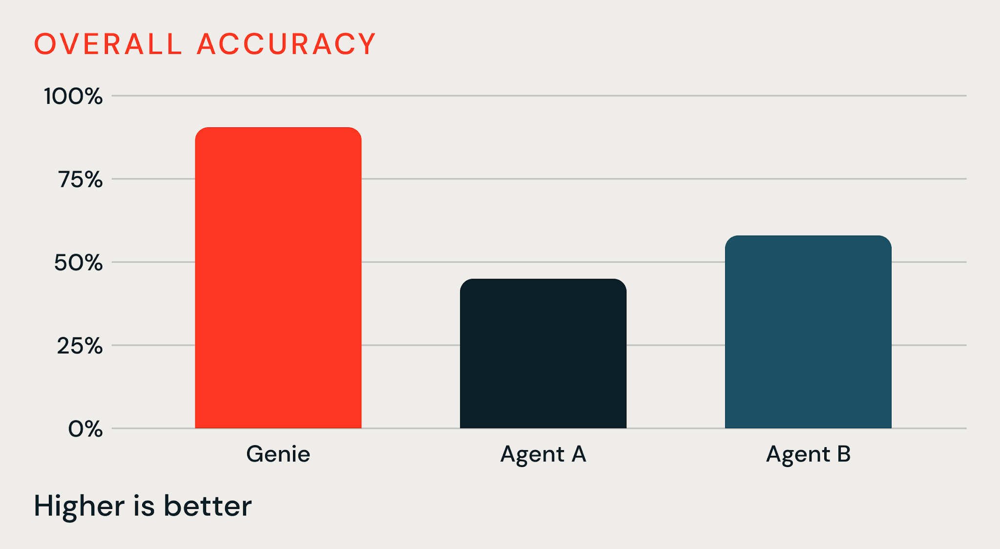

Todo benchmark de agente de IA sobre dado corporativo esbarra no mesmo problema de design: tabela sozinha raramente carrega o conhecimento que decide se uma resposta está certa. A regra de negócio que explica por que uma taxa mudou de ano pra ano normalmente mora num notebook, não numa coluna.

A Databricks publicou um benchmark construído com a Turing exatamente em cima dessa lacuna, comparando o Genie, usando Genie Ontology, agora em disponibilidade geral, contra dois agentes de fronteira não identificados, dentro de um workspace fictício desenhado pra imitar a bagunça real de uma empresa que já roda há anos.

## O ambiente de teste: uma distribuidora de energia fictícia cheia de ruído real

O workspace de teste simula a "Calderwick Energy", uma distribuidora de eletricidade e gás no Reino Unido, com centenas de tabela, a maior com cerca de 120 milhões de linha de leitura de medidor a cada meia hora, além de notebook, job agendado, dashboard, consulta salva, documento e agente Genie já configurado. O detalhe que separa isso de um benchmark limpo de laboratório é a bagunça intencional incluída de propósito, notebook copiado, análise abandonada, documento antigo, cópia de ambiente de desenvolvimento, tabela de relatório congelada. É o tipo de ambiente que qualquer empresa reconhece, não uma vitrine arrumada.

## O exemplo que mostra a diferença: achar a taxa de planejamento certa

O caso ilustrativo citado é direto: uma coluna chamada `cfd_rate_p` mostra valor 0,31 numa tabela consolidada de custo. Só que um notebook específico, sem ligação óbvia com essa tabela, explica que a área comercial define taxa de planejamento por ano fiscal, e que aquele valor específico corresponde ao ano fiscal seguinte, não ao atual, que na verdade vale 0,52. Rodando cinco vezes, o Genie com Genie Ontology devolveu consistentemente o valor correto (0,52) nas cinco tentativas, enquanto os dois agentes concorrentes, sem acesso à mesma camada de contexto, devolveram o valor da coluna errada ou ficaram em dúvida sobre a existência de valor específico por ano.

## Os números, e a conta que não fecha sozinha

| Agente | Taxa de acerto | Tempo médio por execução | Token médio por execução |
|---|---|---|---|
| Genie | 91,0% | 100,3 | 431.829 |
| Agente A | 45,0% | 434,6 | 889.019 |
| Agente B | 58,0% | 306,5 | 1.051.070 |

O título do artigo promete 1,6 vezes mais acurácia, só que o próprio texto não deixa claro contra qual dos dois concorrentes essa conta se refere, e o corpo do texto usa "+46%" e "+33%" ao lado dos mesmos dados, só que esses dois números são diferença em ponto percentual (91 menos 45, 91 menos 58), não ganho relativo. Dividindo 91 por 58, dá 1,57 vezes, perto do título. Dividindo 91 por 45, dá 2,02 vezes, bem mais que o título anuncia. "Menos da metade dos tokens" também varia dependendo de qual concorrente serve de base, 48,6% contra o Agente A, 41,1% contra o Agente B.

**Minha leitura:** isso não invalida o resultado central, Genie claramente ganhou nos três eixos medidos, mas apresentar um título chamativo baseado numa conta que nem o próprio corpo do texto reproduz de forma consistente é o tipo de inconsistência que vale sinalizar antes de citar o número solto numa conversa técnica. Trate "1,6 vezes" como uma aproximação de uma faixa entre 1,6 e 2,0 vezes, dependendo do concorrente de comparação, não como um número único e preciso.

## Mão na massa: auditando onde o conhecimento tácito do seu workspace realmente mora

Antes de assumir que esse tipo de ganho se replica no seu ambiente, vale medir a proporção de contexto de negócio que hoje só existe dentro de notebook e documento, nunca formalizada como metric view ou definição certificada no Unity Catalog:

```sql
SELECT
  table_catalog,
  table_schema,
  COUNT(*) AS total_tabelas,
  SUM(CASE WHEN comment IS NULL OR comment = '' THEN 1 ELSE 0 END) AS sem_descricao
FROM system.information_schema.tables
WHERE table_catalog NOT IN ('system', 'samples')
GROUP BY ALL
HAVING sem_descricao > 0
ORDER BY sem_descricao DESC;
```

Quanto maior a proporção de tabela sem descrição formal, maior a chance de o conhecimento equivalente àquele notebook de taxa de planejamento estar espalhado informalmente pelo seu workspace, exatamente o tipo de lacuna que motivou o benchmark em primeiro lugar.



## No Azure Databricks, o custo real depende de qual motor está atrás do Unity Gateway

O benchmark reporta token médio por execução, mas nunca diz qual provedor de modelo gerou esses token, nem qual contrato de preço foi usado pra calcular o custo citado. Isso importa porque, no Azure Databricks, o Unity Gateway governa o acesso a provedor de modelo externo ao workspace, e o Azure OpenAI é um dos tipos de provedor documentado, com autenticação por chave de API, principal de serviço do Microsoft Entra ID, ou credencial de serviço do Unity Catalog referenciada por nome.

Se o seu ambiente rotear Genie e agente concorrente pelo Azure OpenAI em vez de modelo hospedado direto pela Databricks, o número de token do benchmark não converte automaticamente pro seu custo real. Contrato pay-as-you-go e contrato de capacidade reservada têm preço por token completamente diferente, e nenhum dos dois foi informado no material original. A comparação de "menos da metade dos token" continua válida como proxy de eficiência de raciocínio, mas a tradução direta pra economia em reais exige refazer a conta em cima do seu próprio contrato de Azure OpenAI, não assumir o que os autores do benchmark pagaram.

**Na prática:** isso reforça o ceticismo já levantado sobre a conta do "1,6 vezes", no Azure Databricks especificamente existe mais uma variável não divulgada empilhada em cima da inconsistência percentual já documentada, o provedor e o contrato de preço por trás do token.

## O que isso não resolve sozinho

O benchmark roda num único workspace fictício, com número de tarefa não divulgado, e os dois agentes concorrentes nunca são nomeados por modelo nem versão, o que impede qualquer tentativa de reprodução independente. O conjunto de dado não é público, acesso depende de contato direto com o time de conta da Databricks. A rubrica de avaliação foi definida e aplicada pelos próprios autores, sem intervalo de confiança nem variância reportada além da média de cinco execuções. E os próprios autores reconhecem que a vantagem tende a encolher em ambiente novo, onde tabela e schema já bastam sozinhos pra responder a pergunta. No Azure Databricks, soma-se a isso a ausência de informação sobre provedor de modelo e contrato de preço, o que impede qualquer conversão direta do token médio reportado pra custo real em produção.

## Vale a pena confiar no número?

O argumento de fundo, que modelo de fronteira cada vez mais parece commodity e o que diferencia um agente é a camada de contexto de negócio que ele consegue recuperar, é defensável e consistente com o que a própria Databricks já vem reforçando desde o Genie Ontology original. Mas o número específico de "1,6 vezes" merece ser tratado como direcional, não como medição precisa, dada a inconsistência na própria apresentação dos dados. Vale usar esse benchmark como motivação pra organizar o próprio conhecimento tácito em metric view e definição certificada, não como prova isolada de que qualquer agente genérico vai performar pior que o Genie no seu ambiente específico.

## Referências

- Databricks Blog, "Genie with Genie Ontology Delivers 1.6x the Accuracy with Less than Half the Tokens": https://www.databricks.com/blog/genie-genie-ontology-delivers-16-accuracy-less-half-tokens
- Databricks Blog, "Announcing GA of Genie Ontology": https://www.databricks.com/blog/announcing-ga-genie-ontology
- Databricks Docs, Genie Ontology: https://docs.databricks.com/aws/en/genie/genie-ontology
- Microsoft Learn, Genie Ontology no Azure Databricks: https://learn.microsoft.com/en-us/azure/databricks/genie/genie-ontology
- Microsoft Learn, provedor de modelo externo no Unity Gateway (inclui Azure OpenAI): https://learn.microsoft.com/en-us/azure/databricks/ai-gateway/model-provider-services
- Turing, parceiro de benchmark: https://www.turing.com/

#AzureDatabricks #Genie #Benchmark #Opiniao
