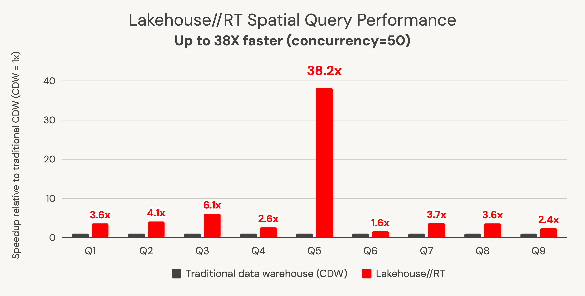

Um benchmark publicado recente promete consulta geoespacial até 38 vezes mais rápida rodando sobre o Lakehouse//RT, o novo warehouse serverless de baixa latência da Databricks. É o tipo de número que já merece ir direto pro backlog de teste. Só que a própria documentação oficial, atualizada no mesmo dia do anúncio, descreve uma limitação que contradiz diretamente a premissa central do benchmark.

## O que o benchmark divulgado realmente mediu

O material de origem atribui o ganho de performance ao tipo de dado GEOMETRY nativo, que habilita otimização de consulta e salto de arquivo irrelevante direto no mecanismo de armazenamento, recomendando inclusive remover a chamada `ST_GeomFromWKB` de dado já armazenado em formato binário. Usando o SpatialBench como carga de teste, o ganho reportado foi de até 20 vezes mais rápido com usuário único e até 38 vezes mais rápido com 50 usuário simultâneo, mantendo consulta SQL espacial já existente sem exigir reescrita nem licença nova.

## A contradição que a documentação atual revela

A documentação de limitação do Lakehouse//RT, tanto a versão para AWS quanto a versão específica para Azure Databricks, ambas atualizadas no mesmo dia da publicação do benchmark, lista explicitamente, na seção de linguagem SQL suportada: tipo de dado GEOGRAPHY e GEOMETRY não suportado, e função SQL espacial listada ao lado de função de IA e UDF Python como recurso não suportado nesse warehouse específico. Isso não é uma leitura isolada de um texto desatualizado, é a mesma frase, nas duas documentações regionais, datada do mesmo dia em que o anúncio de performance foi publicado.

## Mão na massa: como checar você mesmo antes de confiar no anúncio

Antes de assumir que o ganho reportado já vale pro seu workspace, o teste mais direto é tentar rodar uma consulta espacial simples contra um warehouse Lakehouse//RT já habilitado via Preview, e observar o comportamento real:

```sql
-- Criado contra uma tabela gerenciada do Unity Catalog com coluna GEOMETRY,
-- rodando especificamente num warehouse do tipo Lakehouse//RT (Real-Time)
SELECT
  id_regiao,
  ST_Area(geometria)
FROM mapas.gold.regioes_administrativas
WHERE ST_Contains(geometria, ST_Point(-46.63, -23.55));
```

Segundo a documentação atual, essa consulta deveria retornar um erro nomeando a função ou o tipo de dado como não suportado nesse warehouse, não o resultado esperado. Se isso de fato acontecer no seu ambiente, o comportamento documentado está correto e o benchmark divulgado ainda não reflete o que está disponível de forma geral. Se a consulta rodar normalmente, então a limitação documentada já está desatualizada em relação ao comportamento real da plataforma, vale reportar a discrepância pro time de documentação da Databricks.

## O que Lakehouse//RT já suporta sem contradição

Fora da parte espacial, a documentação é consistente sobre o que o mecanismo cobre hoje: consulta de leitura em modo ANSI estrito contra tabela gerenciada do Unity Catalog, incluindo Delta Lake e Apache Iceberg, visão materializada, tabela de streaming e metric view, acessível via SQL editor, notebook, dashboard AI/BI, Catalog Explorer e alerta. A conexão exige a Statement Execution API especificamente, o protocolo Thrift legado não é aceito, então driver antigo que não declara uso explícito da API recebe erro.



**Minha leitura:** esse tipo de discrepância entre anúncio de marketing e documentação técnica atual é exatamente o motivo de nunca tratar número de benchmark divulgado como fato consolidado sem checar a documentação publicada no mesmo período. Não dá pra saber com certeza, de fora, se o benchmark foi medido contra uma build interna ainda não espelhada na documentação pública, se o suporte espacial foi revertido depois de medido, ou se a lista de limitação é só um texto genérico reaproveitado sem revisão específica pra esse recurso. O que dá pra afirmar com segurança é que, hoje, o texto oficial e o anúncio de performance não contam a mesma história, e isso sozinho já justifica testar antes de prometer esse ganho pra qualquer stakeholder.

## O que isso não resolve sozinho

Lakehouse//RT inteiro ainda está em Beta, com característica de performance e conjunto de recurso suportado sujeitos a mudar antes da disponibilidade geral, segundo a própria documentação. O mecanismo é só leitura, sem suporte a `INSERT`, `UPDATE`, `MERGE` nem comando de manutenção de Delta Lake como `OPTIMIZE` ou `VACUUM`. Genie, Genie Agents e tarefa de Job também não são suportados ainda, nem controle de acesso baseado em atributo do Unity Catalog, então qualquer governança fina de linha ou coluna precisa continuar vivendo fora desse warehouse específico por enquanto.

## Vale a pena acompanhar esse recurso?

O conceito por trás do Lakehouse//RT, warehouse serverless dedicado a baixíssima latência sem camada de serviço separada, é genuinamente interessante e vale acompanhar a evolução. Mas pra geoespacial especificamente, a recomendação prática agora é testar diretamente no seu próprio ambiente antes de assumir o ganho divulgado, e revisitar a documentação de limitação periodicamente, porque ela está sendo atualizada ativamente enquanto o recurso ainda está em Beta, o texto de hoje pode já estar diferente amanhã, pra melhor ou pra pior.

## Referências

- Databricks Blog, "Geospatial queries are up to 38X faster with Lakehouse//RT": https://www.databricks.com/blog/geospatial-queries-are-38x-faster-lakehousert
- Databricks Docs, Lakehouse Real-Time (limitações e recursos suportados): https://docs.databricks.com/aws/en/compute/sql-warehouse/real-time
- Microsoft Learn, Lakehouse Real-Time no Azure Databricks: https://learn.microsoft.com/en-us/azure/databricks/compute/sql-warehouse/real-time
- Microsoft Learn, funções geoespaciais H3: https://learn.microsoft.com/en-us/azure/databricks/sql/language-manual/sql-ref-h3-geospatial-functions
- SpatialBench, projeto de benchmark geoespacial Apache Sedona: https://sedona.apache.org/spatialbench/

#AzureDatabricks #LakehouseRT #Geoespacial #Opiniao
