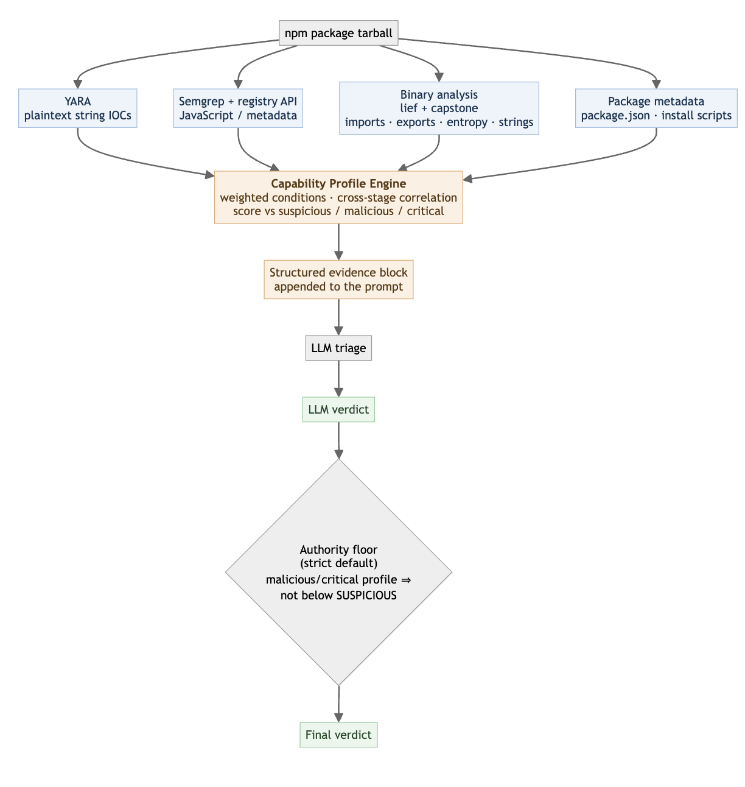

Pacote npm que embute binário compilado é uma fração pequena do ecossistema, cerca de 3,8% do total, mas é desproporcionalmente difícil de avaliar: um modelo de linguagem encarregado de triagem de malware falha em chegar a veredito decisivo contra esse tipo de pacote mais que o dobro das vezes comparado a pacote só com código-fonte JavaScript.

A resposta de uma pesquisa recente não foi trocar de modelo nem re-treinar nada, foi injetar conhecimento de especialista de segurança direto no prompt, antes do modelo começar a raciocinar sobre a evidência.

## Por que binário dentro de pacote engana o modelo

Código JavaScript é relativamente fácil de inspecionar, tanto por ferramenta estática quanto por modelo de linguagem lendo o texto direto. Binário compilado embutido num pacote é outra categoria de problema: a evidência observável vira metadado estrutural, import de biblioteca do sistema, seção de código, string extraída, não mais texto legível que já carrega intenção explícita. Taxa de falha em chegar a veredito decisivo sobe de 6,2% pra 14,4% só por causa dessa mudança de superfície de evidência, mesmo mantendo o mesmo modelo e o mesmo pipeline de análise estática por trás.

## O mecanismo: perfil de capacidade injetado antes do raciocínio

A peça central do desenho é o perfil de capacidade, um roteiro declarativo que codifica uma técnica maliciosa específica, roubo de credencial, mecanismo de persistência, como um conjunto de condição ponderada avaliada contra a evidência estática já coletada. Cada perfil tem limiar próprio de suspeita, de malícia e de criticidade, numa escala separada do veredito final que o modelo vai dar. Quando um perfil cruza o limiar, o motor injeta um resumo estruturado de cerca de 1.800 tokens no prompt, antes do modelo processar o resto da evidência, mas sem forçar o veredito, o modelo ainda pode discordar do perfil e decidir de forma independente.

## Mão na massa: a forma de um perfil de capacidade

Um perfil de capacidade, simplificado, pra técnica de roubo de credencial via variável de ambiente:

```yaml
nome: roubo_credencial_variavel_ambiente
tecnica: credential_harvesting
condicoes:
  - evidencia: "acesso_a_process_env"
    peso: 0.3
  - evidencia: "conexao_de_rede_saida_destino_nao_documentado"
    peso: 0.4
  - evidencia: "ofuscacao_de_string_em_binario_nativo"
    peso: 0.3
limiares:
  suspeito: 0.3
  malicioso: 0.6
  critico: 0.85
resumo_injetado_no_prompt: >
  Este pacote contem binario nativo que acessa variavel de ambiente
  do processo, abre conexao de rede para destino nao documentado
  na metadata do pacote, e usa string ofuscada. Esse padrao combinado
  e consistente com tecnica de exfiltracao de credencial via binario.
  Avalie a evidencia apresentada considerando esse contexto.
```

O ponto central é que o perfil não decide sozinho, ele só garante que o modelo chegue ao raciocínio final já com o contexto de especialista relevante disponível, em vez de precisar inferir isso do zero a partir de evidência bruta e fragmentada.

## Os quatro jeitos que um modelo barato erra sozinho

Sem o perfil injetado, os erros de modelo barato se agrupam em quatro padrão recorrente: racionalização, quando o modelo reconhece o comportamento suspeito mas inventa justificativa benigna pra ele; dispensa, quando o modelo ignora o sinal sem examinar de verdade, mais comum em modelo de peso aberto; hesitação, quando o modelo evita comprometer-se com um veredito claro; e confabulação, quando o modelo inventa detalhe que não está na evidência real, incluindo endereço fabricado na própria análise. Esses quatro padrão juntos explicam a maior parte da falha observada, e são exatamente o tipo de erro que injetar contexto correto, não mais poder de computação, tende a corrigir.



**Minha leitura:** o dado mais revelador aqui não é o ganho médio de detecção, é o quanto ele varia por modelo. Um modelo foi de zero pra sete de dez detecções, outro já estava em nove de dez sem perfil nenhum. Isso sugere que o perfil de capacidade não substitui a capacidade de raciocínio de base do modelo, ele fecha especificamente a lacuna de contexto de domínio que falta pro modelo aplicar o raciocínio que já tem. Pra quem for considerar esse padrão, vale medir onde seu próprio modelo mais falha antes de assumir que o perfil vai ajudar igual em toda situação.

## Validação em produção contra pacote real

A validação final rodou contra um conjunto misto de pacote malicioso confirmado e pacote benigno popular, mais de um milhão de download mensal, sem entrada conhecida de vulnerabilidade. O sistema completo chegou a precisão de 0,77 e recall de 0,81, com o perfil de capacidade de binário respondendo sozinho por 74% das detecções corretas. Votação por maioria entre múltiplos modelos não corrigiu o problema de base, porque os erros de modelo diferente tendem a ser correlacionados, não independentes, o tipo de achado que desmonta a suposição comum de que só rodar vários modelo em paralelo já resolve confiabilidade.

## O que isso não resolve sozinho

Esse é um artigo de pesquisa, não anúncio de produto ou ferramenta de código aberto liberada, não existe repositório de código linkado pra reproduzir o experimento inteiro. A verdade de referência usada vem de rótulo no nível de pacote de uma base pública de vulnerabilidade, que não isola exatamente qual artefato dentro do pacote é malicioso, uma limitação que os próprios autores reconhecem. E mesmo quando o perfil ajuda o modelo a chegar no veredito certo, categoria específica do tipo de malware atribuída pelo modelo barato ainda erra com frequência, então o resultado serve de pista de triagem, não de atribuição forense confiável.

## Vale a pena adotar o padrão?

A ideia central, conhecimento de especialista como condição ponderada avaliada antes do modelo raciocinar, não como re-treinamento nem fine-tuning, é replicável em qualquer pipeline de triagem automatizada que já tenha análise estática rodando por baixo. O investimento real está em identificar os poucos padrões de erro que mais prejudicam seu próprio modelo hoje, as quatro categorias documentadas aqui são um bom ponto de partida, e escrever perfil específico pra fechar essas lacunas, em vez de tentar cobrir toda técnica maliciosa possível de uma vez.

## Referências

- Databricks Blog, "Closing the Binary Blind Spot: Domain-Knowledge Injection for LLM Malware Triage in npm Packages": https://www.databricks.com/blog/closing-binary-blind-spot-domain-knowledge-injection-llm-malware-triage-npm-packages
- OpenSSF, repositório de pacote malicioso conhecido: https://github.com/ossf/malicious-packages
- VirusTotal, documentação do YARA: https://docs.virustotal.com/docs/what-is-yara
- Semgrep, documentação oficial: https://semgrep.dev

#IA #Seguranca #LLM #Pesquisa
