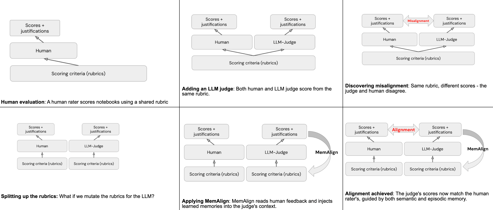

Construir um juiz de IA pra avaliar saída de agente em domínio técnico específico, geração automática de notebook de machine learning, por exemplo, esbarra num problema comum: o juiz genérico aplica um critério razoável na média, mas diverge do especialista humano justamente nas dimensões mais específicas do domínio, onde a diferença entre "bom" e "ótimo" depende de convenção que só quem já viveu aquele contexto sabe reconhecer.

A resposta publicada recentemente pro MLflow não foi re-treinar o modelo por trás do juiz, foi dar a ele memória: um conjunto de diretriz geral extraída do feedback humano, mais um conjunto de caso específico onde o juiz já errou antes, recuperado por similaridade no momento de cada nova avaliação.

## Memória semântica e episódica: como funciona sem fine-tuning

O mecanismo central separa dois tipos de memória que se complementam. Memória semântica guarda diretriz generalizada, destilada do feedback humano, do tipo que se aplica amplamente a qualquer caso daquela dimensão. Memória episódica guarda caso específico onde o juiz errou antes, funcionando como âncora concreta, recuperada por busca de vizinho mais próximo no momento de avaliar um caso novo parecido. No momento da avaliação, o contexto final do juiz combina a rubrica original, as diretrizes semânticas relevantes e os exemplos episódicos mais próximos do caso em questão, sem exigir reescrever nem re-treinar o modelo que serve de juiz.

## Mão na massa: alinhando um juiz de qualidade de notebook no MLflow

O fluxo de três etapas, gerar avaliação inicial, coletar feedback humano com o mesmo nome do juiz, alinhar e registrar, se aplica tanto a juiz embutido quanto a juiz customizado criado com `make_judge`. Adaptando pro cenário de avaliar uma dimensão específica de notebook gerado por agente, treino de modelo:

```python
import mlflow
from mlflow.genai.judges import make_judge
from mlflow.genai.judges.optimizers import MemAlignOptimizer
from mlflow.entities import AssessmentSource, AssessmentSourceType

juiz_treino_modelo = make_judge(
    name="qualidade_treino_modelo",
    instructions=(
        "Avalie em uma escala de 1 a 3 se o codigo de treino de modelo em "
        "{{ outputs }}, gerado a partir do pedido em {{ inputs }}, segue boa "
        "pratica de validacao cruzada, escolha de metrica adequada ao "
        "problema e ausencia de vazamento de dado entre treino e teste."
    ),
    model="databricks:/databricks-claude-sonnet-4-6",
)

# Depois de rodar o juiz contra um lote de notebooks reais e registrar
# a avaliacao de especialista humano usando o mesmo nome do juiz:
mlflow.log_feedback(
    trace_id=id_do_trace,
    name=juiz_treino_modelo.name,
    value="1",
    rationale="Modelo foi avaliado no mesmo conjunto usado no treino, sem holdout",
    source=AssessmentSource(source_type=AssessmentSourceType.HUMAN, source_id="revisor_ml"),
)

tracos_para_alinhamento = mlflow.search_traces(
    experiment_ids=[id_experimento], max_results=50, return_type="list"
)

juiz_alinhado = juiz_treino_modelo.align(
    tracos_para_alinhamento, MemAlignOptimizer(model="databricks:/databricks-gpt-oss-120b")
)
juiz_alinhado.register(experiment_id=id_experimento, name="qualidade_treino_modelo_alinhado")
```

O detalhe que facilita adoção é o nome do feedback precisar bater exatamente com o nome do juiz, pequeno detalhe de convenção que, se ignorado, faz o alinhamento simplesmente não encontrar nenhum par de avaliação pra aprender.

## Os números: onde alinhar ajudou, e onde não ajudou nada

Validado com validação cruzada de quatro grupos sobre 50 notebook avaliado por especialista humano em nove dimensão diferente, o ganho não foi uniforme. Nas três dimensões mais problemáticas, erro médio absoluto caiu de forma expressiva e estatisticamente significativa: treino de modelo caiu 74%, uso do modelo treinado caiu 78%, imputação de dado caiu 89%. Em contraste, quatro das nove dimensões já começavam com erro baixo o suficiente (abaixo de 0,10 numa escala de três pontos) que não havia margem relevante de ganho, e pelo menos uma dimensão, exploração de dado, não mostrou melhoria estatisticamente significativa mesmo depois do alinhamento.

Um experimento de controle isolando só a memória semântica, sem a parte episódica, mostrou o quanto cada peça contribui separadamente: o ganho em treino de modelo caiu pela metade sem a memória episódica, uso do modelo deixou de ser estatisticamente significativo, e pelo menos uma dimensão chegou a piorar em relação à linha de base quando só a diretriz semântica geral era aplicada, sem o exemplo concreto de erro passado pra ancorar o julgamento.



**Minha leitura:** o resultado do experimento de controle é o dado mais interessante aqui, maior do que o número de redução de erro em si. Ele sugere que diretriz geral sozinha, o tipo de coisa que cabe facilmente num prompt mais longo escrito à mão, não é o que resolve divergência de juiz em dimensão técnica específica. É o exemplo concreto de erro passado, recuperado no momento certo, que carrega a maior parte do peso. Isso muda onde vale investir esforço, menos tempo escrevendo instrução mais detalhada, mais tempo coletando e organizando exemplo real de discordância entre juiz e humano.

## O que isso não resolve sozinho

Alinhamento de juiz não cobre avaliação multi-turno nem avaliação baseada em agente inteiro, só avaliação de resposta ou trace individual. O processo ainda depende de volume mínimo de feedback humano rotulado, dez traço como mínimo absoluto segundo a documentação, cinquenta a cem recomendado pra resultado mais confiável, então não elimina o trabalho de anotação, só reduz drasticamente quanto é necessário comparado a re-treinar um modelo do zero. E nada no material disponível discute como o custo de busca por similaridade na memória episódica se comporta conforme o volume de exemplo acumulado cresce ao longo do tempo, vale medir isso antes de assumir que o mecanismo continua barato em escala de produção madura.

## Vale a pena adotar?

Pra qualquer time que já mantém juiz de IA customizado pra avaliar saída de agente em domínio técnico específico, alinhar com uma dúzia a uma centena de exemplo rotulado é um investimento pequeno comparado ao ganho de concordância relatado, principalmente se a dimensão avaliada já mostra discordância visível em relação ao julgamento de especialista humano. O ponto que merece atenção real na adoção é não pular a coleta de exemplo episódico achando que diretriz geral bem escrita já resolve, o próprio experimento de controle mostrou que não resolve sozinha.

## Referências

- Databricks Blog, "Using MemAlign to Improve Evaluation of Traditional Machine Learning in Genie Code": https://www.databricks.com/blog/using-memalign-improve-evaluation-traditional-machine-learning-genie-code
- Databricks Blog, "MemAlign: Building Better LLM Judges with Human Feedback and Scalable Memory": https://www.databricks.com/blog/memalign-building-better-llm-judges-human-feedback-scalable-memory
- Databricks Docs, alinhar juízes LLM com feedback humano: https://docs.databricks.com/aws/en/mlflow3/genai/eval-monitor/align-judges
- Microsoft Learn, alinhar juízes LLM no Azure Databricks: https://learn.microsoft.com/en-us/azure/databricks/mlflow3/genai/eval-monitor/align-judges
- MLflow Docs, MemAlign: https://mlflow.org/docs/latest/genai/eval-monitor/scorers/llm-judge/memalign/

#AzureDatabricks #MLflow #AvaliacaoDeAgentes #GenieCode
