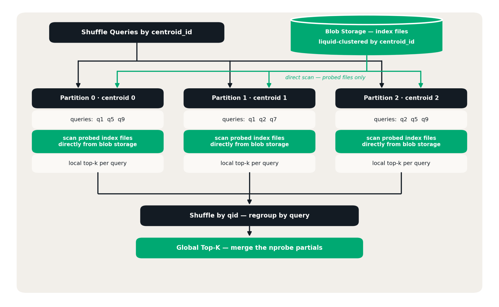

Toda vez que um time precisa comparar milhões de registros contra milhões de outros, deduplicar cliente, resolver entidade, classificar item por similaridade, a primeira tentativa costuma ser a mesma: apontar um loop pra um endpoint de vector search em tempo real, uma chamada por linha. Funciona em prova de conceito. Quebra em produção, porque o teto de throughput vira o tamanho do endpoint, não o tamanho do cluster que está rodando o job.

A cláusula `NEAREST BY`, nova no Databricks SQL, muda o enquadramento do problema: em vez de tratar busca vetorial como uma chamada de API por registro, ela vira um tipo de join com ranking top-k embutido, processado pelos mesmos operadores relacionais que já distribuem, derramam em disco e retentam qualquer outro join grande no motor.

## O gargalo que uma chamada por linha sempre vai ter

Um endpoint de serving em tempo real é ótimo pra responder uma pergunta de cada vez com baixa latência, não pra processar um lote de milhões de perguntas de uma vez. Quando o padrão de uso é "para cada uma dessas 10 milhões de linhas, ache as 5 mais parecidas num catálogo de 1 bilhão", o endpoint vira o teto artificial do throughput, não importa quão grande seja o cluster Spark disparando as chamadas. É o tipo de limite que só aparece quando o volume cresce, exatamente quando já é tarde pra redesenhar a arquitetura com calma.

## O que muda: busca vetorial como join, não como chamada de API

`NEAREST BY` estende a sintaxe de `JOIN` com um parâmetro de ranking: você escolhe `APPROX` ou `EXACT`, `BY DISTANCE` ou `BY SIMILARITY`, um número de resultados por linha, e uma expressão de pontuação, normalmente `vector_cosine_similarity`, `vector_l2_distance` ou `vector_inner_product`. O otimizador reescreve isso internamente como um cross join seguido de uma agregação top-k agrupada, tudo dentro do mesmo pipeline que já cuida de distribuição e tolerância a falha de qualquer consulta SQL comum, sem exigir infraestrutura de serving separada pra esse tipo de carga em lote.

## Mão na massa: sugerindo ticket parecido sem sair do SQL

Um caso de uso direto é suporte técnico: dado um ticket novo, achar os tickets já resolvidos mais parecidos pra sugerir a solução antes de escalar pra um humano. Supondo que `tickets_novos` e `tickets_resolvidos` já tenham uma coluna `embedding` do tipo `ARRAY<FLOAT>`, gerada antes via `ai_query` contra um modelo de embedding:

```sql
SELECT
  novo.ticket_id,
  novo.assunto,
  resolvido.ticket_id AS ticket_similar,
  resolvido.solucao_aplicada
FROM tickets_novos AS novo
LEFT OUTER JOIN tickets_resolvidos AS resolvido
  APPROX NEAREST 3 BY SIMILARITY
    vector_cosine_similarity(novo.embedding, resolvido.embedding);
```

O `LEFT OUTER` garante que todo ticket novo apareça no resultado, mesmo que nenhum candidato ultrapasse um limiar implícito de similaridade, nesse caso as colunas do lado resolvido vêm como `NULL`. Trocar `APPROX` por `EXACT` troca velocidade por garantia de top-k exato, útil quando o caso de uso não tolera aproximação, como numa auditoria de deduplicação de cliente antes de uma fusão de cadastro.

## Por baixo do capô: por que lote vence chamada individual

A justificativa técnica por trás do ganho de performance é um argumento clássico de roofline model: uma chamada individual por linha tem intensidade aritmética baixa, perto de 0,25 segundo o material técnico da Databricks, rodando bem abaixo de 1% do pico teórico de FLOPS da máquina. Quando o motor processa um lote de consultas de uma vez, a mesma operação vira uma multiplicação de matriz em bloco (GEMM), cuja intensidade aritmética cresce proporcionalmente ao tamanho do lote, cruzando o ponto de inflexão do roofline a partir de aproximadamente 64 consultas simultâneas. Na prática, isso significa que o kernel fundido no Photon mantém o estado de top-k por consulta enquanto pontua, sem nunca materializar a matriz de pontuação inteira em memória, o motivo técnico de o motor processar bilhões de vetores sem estourar RAM.

## O índice opcional é só uma tabela Delta com clustering líquido

Pra consultas `APPROX`, existe um índice IVF opcional, mas ele não é uma estrutura proprietária escondida, é uma tabela Delta comum, clusterizada por ID de centroide treinado via k-means. Cada consulta aproximada só precisa varrer os clusters mais próximos (`nprobe`), o que em escala de bilhão de vetores reduz a fração do corpus efetivamente examinada pra bem menos de 1%. Linhas inseridas depois do último refresh do índice entram por um caminho de força bruta complementar, então um índice desatualizado reduz a eficiência da poda, não a qualidade do resultado.



**Minha leitura:** o detalhe mais interessante aqui não é o ganho de performance em si, é o índice ser uma tabela Delta normal. Isso significa que ele herda time travel, governança de Unity Catalog e o mesmo pipeline de manutenção que qualquer outra tabela gerenciada já tem, em vez de exigir um sistema de índice vetorial paralelo pra administrar, com seu próprio ciclo de backup e permissão separados. É o tipo de escolha de arquitetura que só aparece boa depois que alguém já sofreu mantendo um índice vetorial externo rodando ao lado do lakehouse.

## O que isso não resolve sozinho

A documentação oficial não confirma o estágio de disponibilidade da cláusula, beta, preview público ou GA, então vale checar o changelog antes de assumir estabilidade de produção. `NEAREST BY` também não roda sobre fonte streaming, útil saber antes de tentar aplicar num pipeline de ingestão contínua. E o ganho de performance pressupõe que a geração do embedding em si, via `ai_query` contra um modelo de serviço, já aconteceu antes, a cláusula acelera a comparação entre vetores já existentes, não a etapa de embutir texto bruto, que continua tendo seu próprio custo e latência de modelo.

## Vale a pena adotar?

Pra qualquer carga de trabalho que hoje depende de chamar um endpoint de vector search em loop dentro de um notebook ou job, migrar pra `NEAREST BY` é quase sempre um ganho direto, porque troca o teto de throughput do endpoint pelo teto de throughput do cluster, que você já controla. O cuidado real fica em três pontos: confirmar o estágio de lançamento antes de depender disso em produção, escolher `APPROX` versus `EXACT` de forma consciente dependendo de quanto a aplicação tolera aproximação, e lembrar que o índice IVF, por ser uma tabela Delta comum, também precisa entrar na rotina normal de manutenção de tabela gerenciada.

## Referências

- Databricks Blog, "NEAREST BY Join: Scaling Vector Search in Databricks Runtime": https://www.databricks.com/blog/nearest-join-scaling-vector-search-databricks-runtime
- Databricks Docs, sintaxe NEAREST BY: https://docs.databricks.com/aws/en/sql/language-manual/sql-ref-syntax-qry-select-nearest-by
- Microsoft Learn, sintaxe NEAREST BY no Azure Databricks: https://learn.microsoft.com/en-us/azure/databricks/sql/language-manual/sql-ref-syntax-qry-select-nearest-by
- Databricks Docs, vector_cosine_similarity: https://docs.databricks.com/aws/en/sql/language-manual/functions/vector_cosine_similarity

#AzureDatabricks #DatabricksSQL #VectorSearch #Performance
