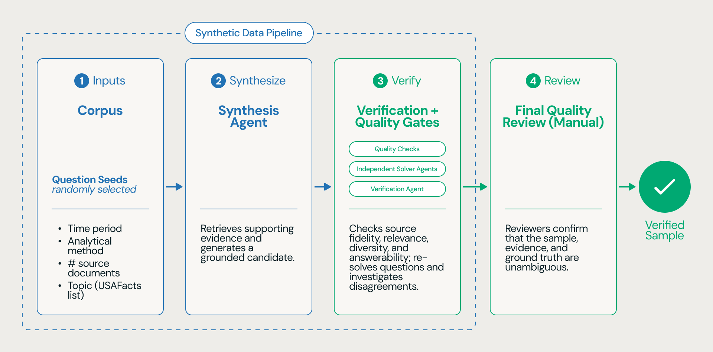

Um agente que vai bem num benchmark de raciocínio sobre documento corporativo pode estar genuinamente raciocinando, ou pode ter só aprendido o jeito particular daquele corpus específico de organizar informação. A única forma de distinguir as duas coisas é testar o mesmo agente contra um corpus diferente que ele nunca viu, e foi exatamente esse teste que motivou a segunda versão de um benchmark de raciocínio fundamentado publicado recentemente.

## Por que testar sempre no mesmo corpus engana

Um benchmark que sempre usa a mesma coleção de documento corre o risco de medir memorização de particularidade daquele corpus, não capacidade de raciocínio generalizável. A pergunta que motivou a segunda versão desse benchmark foi direta: será que o ganho de performance visto no benchmark original realmente significa raciocínio melhor, ou só reflete familiaridade crescente com um corpus específico, de domínio e formato, que times de pesquisa foram otimizando contra?

## Como o corpus novo foi construído com dado sintético verificado

A resposta foi trocar completamente o corpus, usando pela primeira vez um conjunto de 1.400 documentos e cerca de 120 mil página de contas de receita e despesa do governo americano, cobrindo mais de dois séculos, de 1793 a 2024. Gerar pergunta e resposta verificada manualmente contra esse volume não escala, então o processo de geração de dado sintético seguiu um fluxo de várias etapas: um agente de síntese recebe parâmetro inicial, período de tempo aleatório, método analítico, número alvo de documento fonte e tópico relevante, e busca no corpus evidência que sustente uma pergunta genuína com cadeia de raciocínio rastreável. Cada candidato passa por verificação de qualidade, fidelidade à fonte, relevância analítica, diversidade e respondibilidade, e agentes solucionadores independentes tentam responder a pergunta do zero, com um agente de verificação revisando essas tentativas alternativas. Só segue adiante o candidato cuja resposta correta é confirmada de forma independente. Revisor humano faz a checagem final, olhando pergunta, resposta, raciocínio e evidência citada ao lado da solução de modelos de fronteira adicionais, mantendo só o que tem interpretação e verdade inequívocas.

## Mão na massa: o formato de um portão de verificação de pergunta sintética

O princípio central da etapa de verificação, pergunta só avança se um solucionador independente do gerador original consegue responder corretamente a partir do zero, é replicável em qualquer pipeline de dado sintético pra avaliação, não só nesse benchmark específico:

```python
def verificar_pergunta_sintetica(pergunta, resposta_esperada, corpus, solucionadores):
    tentativas = [
        agente_solucionador(pergunta, corpus)
        for agente_solucionador in solucionadores
    ]

    concordam_com_esperado = sum(
        1 for tentativa in tentativas
        if comparar_resposta(tentativa.resposta, resposta_esperada)
    )

    # Só avança se a maioria dos solucionadores independentes,
    # sem ver a resposta esperada, chegou ao mesmo resultado
    if concordam_com_esperado / len(tentativas) < 0.6:
        return None

    return {
        "pergunta": pergunta,
        "resposta": resposta_esperada,
        "evidencia": [t.evidencia_citada for t in tentativas if t.concordou],
        "aprovada_para_revisao_humana": True,
    }
```

Esse portão não substitui a revisão humana final, ele reduz pra uma fração bem menor o volume de pergunta que chega até o revisor, filtrando antes qualquer caso onde nem um solucionador independente conseguiu reproduzir a resposta esperada.

## A competição e os números que ela revelou

O benchmark novo serviu de base pra uma competição ao vivo, com 11 equipe acadêmica apoiada por grandes laboratórios de IA, avaliadas contra corpus e tarefa inéditos, equipes da competição alcançaram em média 41,1% de acurácia, a equipe vencedora chegou a 63,3%. Em paralelo, o material de origem comparou harness genérico de agente de código contra o Genie da Databricks usando os mesmos modelos subjacentes: harness genérico ficou na casa de 26 a 37% dependendo do conjunto de modelo comparado, o Genie, usando os mesmos modelos, chegou a até 60% na configuração mais forte, uma melhoria relativa reportada de cerca de 92% em média. O ganho não veio de um modelo diferente, veio de pré-processar o corpus inteiro com uma função de extração de documento antes de qualquer consulta, reduzindo o quanto o agente precisa reprocessar texto bruto a cada pergunta.



**Minha leitura:** o detalhe mais honesto desse material de origem é justamente não esconder a inconsistência entre dois números de acurácia reportados em lugares diferentes do mesmo texto, um deles citando conjunto de quatro modelos, outro citando cinco. Isso não invalida a conclusão central, mas é um lembrete de que número de benchmark divulgado por quem também vende a solução vencedora merece ceticismo saudável até alguém reproduzir de forma independente, o próprio repositório de avaliação sendo aberto ajuda, mas não substitui essa reprodução.

## O que isso não resolve sozinho

O material de origem não descreve a arquitetura interna do Genie, orquestração, recuperação de evidência, verificação de resposta, então não dá pra saber exatamente qual parte do ganho vem de pré-processamento de documento e qual vem de outras decisões de engenharia dentro do próprio agente. O custo por execução reportado também exclui o custo inicial de processar o corpus inteiro antes da primeira pergunta, relevante pra quem for comparar custo total de propriedade entre abordagem, não só custo marginal por pergunta. E mesmo o sistema vencedor da competição, com 63,3%, deixa claro que ainda existe bastante margem de melhoria num corpus genuinamente novo, nenhuma abordagem testada se aproximou de acurácia alta o suficiente pra tratar o problema como resolvido.

## Vale a pena acompanhar esse benchmark?

Pra qualquer time avaliando agente próprio contra documento corporativo real, a lição metodológica vale mais do que o número específico, testar só contra o corpus que você já otimizou é uma forma de enganar a si mesmo sobre generalização. O padrão de verificação por solucionador independente, mesmo fora do contexto desse benchmark específico, é um jeito prático de escalar geração de caso de teste sintético sem abrir mão de confiabilidade.

## Referências

- Databricks Blog, "Introducing OfficeQA Pro V2: A New Benchmark for Enterprise Grounded-Reasoning": https://www.databricks.com/blog/introducing-officeqa-pro-v2-new-benchmark-enterprise-grounded-reasoning
- Databricks Docs, visão geral do Genie: https://docs.databricks.com/aws/en/genie/
- Microsoft Learn, Genie no Azure Databricks: https://learn.microsoft.com/en-us/azure/databricks/genie/
- Repositório de avaliação OfficeQA (código aberto): https://github.com/databricks/officeqa
- Dataset OfficeQA Pro V2 no Hugging Face: https://huggingface.co/datasets/databricks/officeqa-pro-v2

#AzureDatabricks #Genie #AvaliacaoDeAgentes #Benchmark
